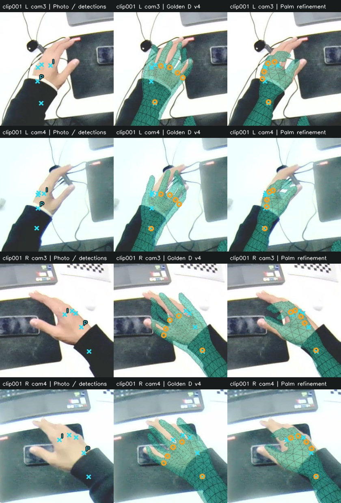

# 四段真实双目 · 掌面朝向试验

[下载四份实验 OBJ（ZIP）](https://github.com/cdh290718-oss/DownSight/releases/download/realvideo4-palm-obj-20261126/realvideo4_palm_OBJ_cam3_m.zip) · [原 v4 图集与 OBJ](../2026-11-25_realvideo4_dv4/report.md)

加入腕和非拇指的四个掌指关节（指根）后，八只手的指根双目重投影误差都下降，腕位置保持稳定。未参与拟合的五个指尖与可见轮廓总体变差。建议保留为同帧诊断分支，继续使用原 v4 作为基线。

## 手部放大对照

每张图分四行：人物左手的 cam3、cam4，再到右手的 cam3、cam4。每行从左到右为原图及检测、原 v4、掌面细化。青叉是 Sapiens2 检测，橙圈是模型投影；I 表示食指根，P 表示小指根。保留相同裁切框和缩放比例。

| 片段 | 双目手部放大 | 完整双目叠加 | OBJ 正侧面 | OBJ 米制下载 |
|---|---|---|---|---|
| 001 | [掌面前后](assets/clip001_hands.jpg) | [左目](assets/clip001_cam3_both.jpg) / [右目](assets/clip001_cam4_both.jpg) | [查看](assets/clip001_obj.jpg) | [下载](https://github.com/cdh290718-oss/DownSight/releases/download/realvideo4-palm-obj-20261126/clip001_palm_cam3_m.obj) |
| 002 | [掌面前后](assets/clip002_hands.jpg) | [左目](assets/clip002_cam3_both.jpg) / [右目](assets/clip002_cam4_both.jpg) | [查看](assets/clip002_obj.jpg) | [下载](https://github.com/cdh290718-oss/DownSight/releases/download/realvideo4-palm-obj-20261126/clip002_palm_cam3_m.obj) |
| 003 | [掌面前后](assets/clip003_hands.jpg) | [左目](assets/clip003_cam3_both.jpg) / [右目](assets/clip003_cam4_both.jpg) | [查看](assets/clip003_obj.jpg) | [下载](https://github.com/cdh290718-oss/DownSight/releases/download/realvideo4-palm-obj-20261126/clip003_palm_cam3_m.obj) |
| 004 | [掌面前后](assets/clip004_hands.jpg) | [左目](assets/clip004_cam3_both.jpg) / [右目](assets/clip004_cam4_both.jpg) | [查看](assets/clip004_obj.jpg) | [下载](https://github.com/cdh290718-oss/DownSight/releases/download/realvideo4-palm-obj-20261126/clip004_palm_cam3_m.obj) |

## 汇总

| 指标 | 原 v4 | 仅 Sapiens2 起点及原姿态起点 | 再加入 WiLoR 起点 |
|---|---:|---:|---:|
| 非拇指四指根 RMSE（px） | 39.44 | 8.41 | 8.41 |
| 腕点 RMSE（px） | 4.00 | 4.00 | 4.00 |
| 五指尖 RMSE（px，未参与点位损失） | 40.63 | 47.97 | 47.97 |
| 相对双目三角化掌面法向的平均夹角（°） | 64.15 | 6.92 | 6.92 |
| 相对 WiLoR 双目平均手形法向的平均夹角（°） | 40.36 | 48.17 | 48.17 |
| v4 双目轮廓距离（px） | 10.75 | 13.17 | 13.17 |

像素 RMSE 按原始分辨率，合并八只手、左右目及相应关节后开根。角度为同侧有向法向的夹角，未对点集做 PA 对齐。轮廓按 v4 的双向截断距离与有效区域平均。指根检测同时用于拟合和计算三角化法向；两者的一致性无法证明掌心朝向正确。WiLoR 是辅助预测。指尖分数来自同一检测器，但这些点没有进入选姿或损失。数据缺少真人掌面朝向真值。[汇总证据](evidence/summary.json)

| 片段 / 手 | 两目合并指根 RMSE（px） | 细化后 cam3 / cam4 指根 RMSE（px） | 相对三角化法向（°）| 五指尖 RMSE（px）|
|---|---:|---:|---:|---:|
| 001 左 | 52.93 → 9.31 | 9.33 / 9.29 | 118.1 → 3.8 | 58.48 → 60.60 |
| 001 右 | 54.15 → 9.38 | 9.44 / 9.31 | 125.5 → 9.2 | 63.17 → 49.33 |
| 002 左 | 41.48 → 8.47 | 8.55 / 8.40 | 72.0 → 8.7 | 34.00 → 52.94 |
| 002 右 | 47.98 → 9.78 | 7.81 / 11.41 | 124.9 → 7.1 | 48.62 → 45.39 |
| 003 左 | 24.63 → 6.98 | 6.69 / 7.26 | 6.4 → 12.1 | 26.11 → 48.84 |
| 003 右 | 20.11 → 9.08 | 7.96 / 10.08 | 27.3 → 3.9 | 30.30 → 41.79 |
| 004 左 | 31.29 → 6.10 | 5.91 / 6.29 | 20.8 → 5.5 | 14.42 → 41.48 |
| 004 右 | 26.37 → 7.43 | 8.09 / 6.70 | 18.1 → 5.1 | 21.61 → 39.82 |

001 的两手原本与三角化法向相差超过 90°，细化后落入 10° 内；003 左手的同一指标由 6.4° 增至 12.1°。指尖在八只手中有六只变差。以 004 左手为例，指根贴近了，两眼合并指尖偏差仍由 14.42 增至 41.48 px。原因可能包括固定的手指弯曲无法跟随真人动作、腕点或指根检测语义和位置偏差；本试验没有分离这些原因。WiLoR 起点只在 003 左手带来数值上很接近的候选，八手汇总未见可区分的收益。

## 拟合与复核

实验起点和发布前核对的远端为 `01726e67a3d06e08f0db0b6f51d88e77b0cd0f36`，执行期间有本轮新增文件及无关工作树改动。复用同帧、同标定、佩戴 Head、已归档 v4 身体与轮廓分割。RW20000 已存 308 个点的原图像素坐标，没有置信度。每侧取腕及食、中、无名、小指根，SMPL-X 对应腕和四个近节指骨起点。WiLoR 使用 Sapiens2 腕引导框，单眼三维手点镜像还原后转到 cam3，再平均两眼腕相对坐标用于提供起始方向。WiLoR 不替换身体腕位置或手网格。

先由双目射线三角化，以同一腕为原点做刚性方向初始化，再比较原姿态、三角化起点和 WiLoR 起点的双目指根细化结果。候选优化使用软 L1，平移通过固定身体和沿前臂自身长轴旋转保持。前臂附加轴向旋转限制为 ±30°，腕部局部轴角幅值限制为 100°，手指和身体其他局部角固定。腕点重建最大位移低于 0.001 mm。以三角化重投影残差和三角化掌宽相对模板的比值连续降低异常手的影响，003 右手权重约 0.21。可靠性与损失权重为本轮工程设定，没有用真值调参。保留原始 v4 身体和轮廓损失再加指根与旋转正则项，以同一目标选姿并作步长 6°、3°、1.5° 的局部搜索。完整系数及判断见脚本，各候选可查。

[001 数值](evidence/clip001.json) · [002 数值](evidence/clip002.json) · [003 数值](evidence/clip003.json) · [004 数值](evidence/clip004.json) · [双目全身总览](assets/overview.jpg)

已核对工作区、暂存内容、增量提交及远端状态。公开实验脚本、精简数值及用户场景的派生可视化，单文件小于 50 MB，核对 JPEG 尺寸、哈希、元数据与链接。完整模型、原始视频、数组、凭据及机器绝对路径留在本地。Release 仅包含相机坐标拟合 OBJ 和相同网格 ZIP，已回读验证拓扑、顶点与压缩包成员。[执行记录](evidence/execution.json) · [附件核验](evidence/attachment_audit.json) · [增量自检](evidence/prepush.json)
