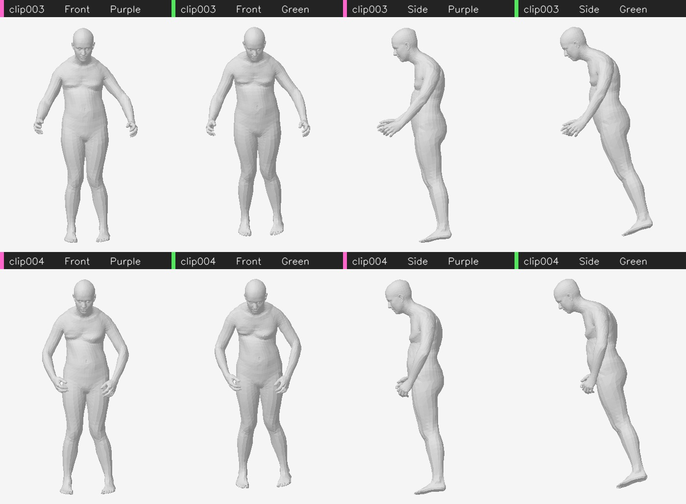
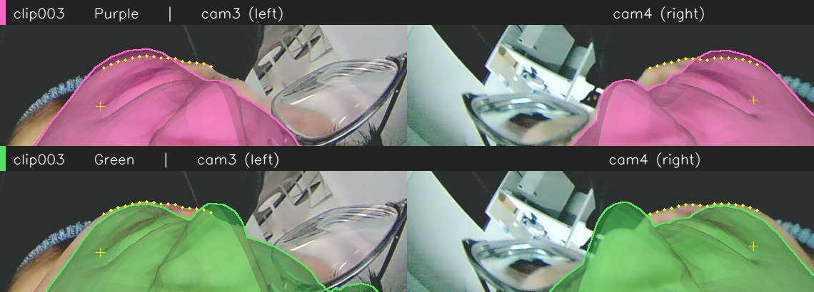
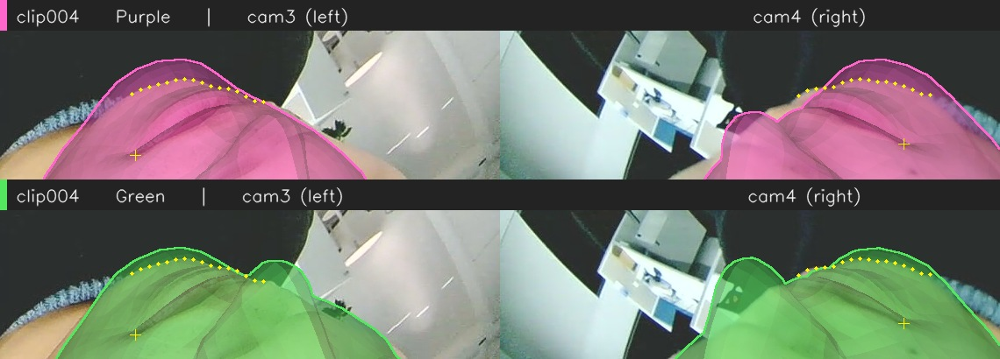

# 003、004 的紫线和绿线对应 OBJ

上排为 003，下排为 004。每排从左到右依次为紫线正面、绿线正面、紫线侧面、绿线侧面。两组共用观察方向、比例和画面中心。原图里的颜色对应两种佩戴标定；全身图保留灰色表面以便比较几何细节。

紫色取两段中间帧联合估计的仅平移参数，绿色取联合估计的 −10° 俯仰及其配套平移，使用[上一轮四对留出帧叠图所用的参数](../2026-11-26_realvideo4_mount_pitch/evidence/temporal.json)。两段各自沿用原黄金 D v4 中间帧的身体、手脚和体型，复现标定时相对相机对整个网格施加的刚体变换。侧面可见绿色全身相对紫色更倾斜，踝膝、腰背和颈部的局部姿态相同。本图没有地面或重力参照。

## 双目原图中的面部网格

各图上排紫色、下排绿色，左列 cam3，右列 cam4。半透明区域来自导出的完整 OBJ 在原相机中首次可见的头面部表面；黄点是图像中提取的脸缘，黄叉是点取的嘴角。这里展示各段中间帧。

## 复现与发布

执行基线 88d405716e1add5628a3538ca8a5f5d642f398c5。工作树含本轮新增文件及其他既有改动。以已有 v4 几何和两组封存参数导出 cam3 米制 OBJ，逐文件读回核对顶点、面索引；在原始鱼眼模型下将头面部遮罩与上一轮逆变换射线的方法逐像素对照。压缩包在开发机仓库的 `outputs/realvideo4_pitch_obj_20261126/clip003_004_purple_green_obj.zip`。在仓库根目录执行本轮 run.sh。退出状态、输入和产物哈希、遮罩差异及回读误差见[渲染记录](evidence/render.json)。

推送前核对工作区、暂存区、待推提交与远端，逐项检查文件大小、类型、JPEG 元数据、凭据与机器路径。发布范围为本轮代码、报告、精简记录及渲染预览。原始数据、网格、压缩包和完整本地运行资料保存在开发机。
