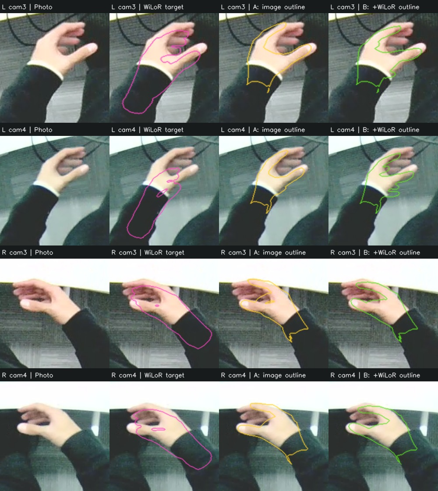

# WiLoR 手部轮廓能否改善四帧真实双目的手形？

在相同的身体、腕位置、手指自由度、拟合起点和预算下，加入原位置 WiLoR 轮廓后，八只手中七只的留出指尖误差增大。建议这四帧采用 A 组作为手部候选，黄金 D v4 默认配置保持原版本。原图为四段真实双目视频各自的一对中间帧，每帧独立拟合。[八个对照 OBJ 下载，cam3 坐标，单位米](https://github.com/cdh290718-oss/DownSight/releases/download/realvideo4-wilor-outline-ab-20261126/realvideo4_wilor_outline_AB_OBJ.zip)

## 双目结果

单位均为原图像素，数值越低越好。起点为上轮固定手指的掌面细化解。A 放开手腕和手指，使用双目指根与 Sapiens2 图像分割轮廓。B 在 A 的目标上加 WiLoR 原位置投影轮廓。

| 指标 | 共同起点 | A | B |
|---|---:|---:|---:|
| 五指尖对留出的 Sapiens2 检测 RMSE | 47.97 | **42.44** | 55.41 |
| 拇指尖 RMSE | 34.28 | **15.18** | 21.40 |
| 小指尖 RMSE | 41.18 | **39.03** | 46.23 |
| 四个指根 RMSE | 8.41 | 8.30 | **8.27** |
| 腕点 RMSE | 4.00 | 4.00 | 4.00 |
| 网格手轮廓到图像分割手轮廓的双向距离 | 10.77 | **6.70** | 7.71 |
| 网格手轮廓到 WiLoR 轮廓的双向距离，按支持度加权 | 10.49 | 11.59 | **9.66** |

关节点 RMSE 合并人物左右手、左右相机和各对应点，先平均平方距离再开方。分割轮廓按有支持的手与视图平均，WiLoR 轮廓按支持度归一化。全部身体主关节和腕中心的最大位移为 0 mm。A、B 与指根三角化掌面法向的平均夹角均约 7.05°。这个角度与拟合使用同一组指根，四帧缺少独立三维手部真值。留出的指尖使用 Sapiens2 检测，遮挡和手指重叠均可能影响这些点。[汇总及单眼腕偏移](evidence/summary.json)

| 片段 | 左手五指尖 A → B（px） | 右手五指尖 A → B（px） | 手部原图和四列对照 | B 原图全身网格、检测与拟合点 | 两组 OBJ 正侧面 |
|---|---:|---:|---|---|---|
| 001 | 61.55 → 69.99 | 41.52 → 62.72 | [放大](assets/clip001_hands.jpg) | [cam3](assets/clip001_cam3.jpg) / [cam4](assets/clip001_cam4.jpg) | [渲染](assets/clip001_obj.jpg) |
| 002 | 43.19 → 53.90 | 43.49 → 68.39 | [放大](assets/clip002_hands.jpg) | [cam3](assets/clip002_cam3.jpg) / [cam4](assets/clip002_cam4.jpg) | [渲染](assets/clip002_obj.jpg) |
| 003 | 31.73 → 47.84 | 40.63 → 55.22 | [放大](assets/clip003_hands.jpg) | [cam3](assets/clip003_cam3.jpg) / [cam4](assets/clip003_cam4.jpg) | [渲染](assets/clip003_obj.jpg) |
| 004 | 34.87 → 41.44 | 35.63 → 33.05 | [放大](assets/clip004_hands.jpg) | [cam3](assets/clip004_cam3.jpg) / [cam4](assets/clip004_cam4.jpg) | [渲染](assets/clip004_obj.jpg) |

每张放大图依次为干净原图、WiLoR 输出的完整预测轮廓（紫）、A 可见手网格轮廓（黄）、B 可见手网格轮廓（绿）。每手两行，分别来自 cam3 和 cam4。B 的全身网格叠加图中，青叉为自动检测，橙圈为最终投影，包含腕、指根与留出指尖。OBJ 图上行为 A，下行为 B，共用中心、缩放和视角。

004 左手的 cam4 上，紫色轮廓有一部分落在黑色袖子上，靠拇指一侧的轮廓也偏向手腕。B 的绿色轮廓在拇指下方多出向外突的边缘。WiLoR 腕点投影与 Sapiens2 腕点的距离在这只手的 cam3、cam4 分别为 17.4、31.9 px。两套模型的腕参照可能有差别；原图显示这一眼的整体轮廓也有位置偏差。B 更贴近这个目标却不一定更贴合原手。左手的拇指尖 RMSE 从 12.97 增至 15.09 px，小指尖从 29.16 增至 34.26 px。004 右手的五指尖 RMSE 有改善。单凭本轮无法把轮廓偏移归因于裁框、相机假设或 WiLoR 手形中的某一项。[004 分眼分指数据](evidence/clip004.json)

## 拟合协议与复核

基线及运行时 HEAD 为 2158af2a451eead8bc727270eb4e7a7b01c49f1a。工作树有本轮新增程序和已有无关改动。使用上轮归档的四个掌面姿态、同一套检测与标定、相同的 v4 图像分割。WiLoR 用上一轮腕中心裁框、单眼相机输出和裁框回原图投影，实际运行模型取 MANO 顶点并栅格化；逐眼复核重投影的关节点与上轮缓存一致。SMPL-X 网格使用标定后的双目鱼眼投影，并在完整人体上计算可见性。每只手的 WiLoR 边界只保留邻近对应图像分割手区域的样本，并按保留比例降权。图中紫线展示降权前的轮廓。这一支持度是遮挡的近似值。[WiLoR 掩码指纹与回放误差](evidence/masks.json)

两组均保留图像分割轮廓损失、同样的双目四指根损失、腕与手指旋转正则。固定除手腕外的身体局部关节，腕局部轴角上限 100°，每个手指关节局部轴角上限 45°。两组都从同一个姿态做 70 步 Adam 搜索，保留本组目标最好的迭代，起点也参与选姿。B 对每手每眼的 WiLoR 双向截断边缘距离增加 0.012 的权重（距离除以 12 px，再按支持度加权）。指尖只在选姿完成后评价。两组使用共同设置，本轮只检验这一种权重和原位置轮廓。[拟合代码](paired.py) · [001](evidence/clip001.json) · [002](evidence/clip002.json) · [003](evidence/clip003.json) · [004](evidence/clip004.json)

执行记录包含一次渲染模块命名冲突及修复后的退出状态。网格导出后回读核对面、顶点和 ZIP 成员。推送前核对工作树、暂存、待推提交及远端；本轮增量只含脚本、脱敏证据、报告及请求的派生可视化，单个文件小于 50 MB。相机图像、数组、完整推理输出、凭据和绝对机器路径留在本地。Release 仅发布八个请求的拟合 OBJ 组成的 ZIP。[执行记录](evidence/execution.json) · [附件校验](evidence/attachment_audit.json) · [增量自检](evidence/prepush.json)
