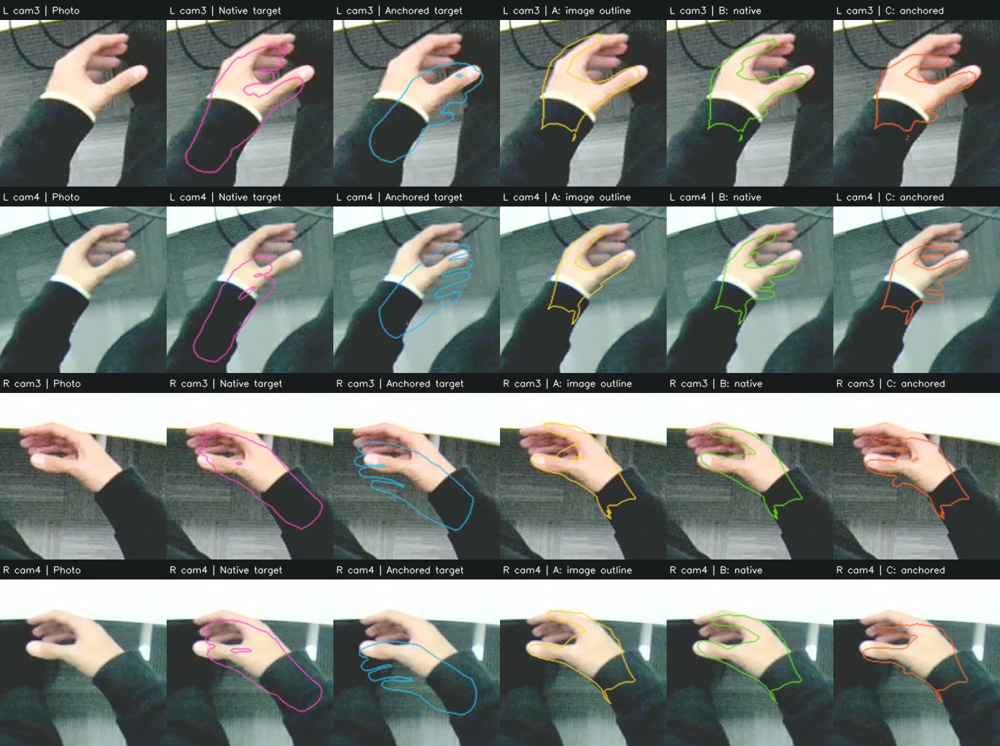

# 把 WiLoR 的三维手形放到双目腕上，手会更准吗？

四对真实双目帧中，用已定位的三维腕重新投影 WiLoR 手形（C），最终五指尖误差从原位置方案（B）的 55.41 降到 47.65 px。只用图像分割轮廓和双目指根（A）仍是这批帧的首选，五指尖为 42.44 px，八只手的分割轮廓距离均优于 C。001 的两只手是 C 改善指尖的例子。建议保留 A 作为这批手部对照的首选。[四个 C 组 OBJ（ZIP，米，左相机 cam3）](https://github.com/cdh290718-oss/DownSight/releases/download/realvideo4-wilor-wrist-c-20261126/realvideo4_wilor_wrist_C_OBJ.zip) · [上轮 A、B 报告与 OBJ](../2026-11-26_realvideo4_wilor_outline/report.md)

## 拟合结果

八只手、左右目合并，点误差为原图像素欧氏距离的 RMSE。四个指根进入优化，五个指尖只在评估时与 Sapiens2 检测比较。手轮廓指标为网格可见手边界与 Sapiens2 分割边界的双向距离。分割也进入共同损失。独立三维真值缺失。

| 指标 | A 原图分割 | B 再加 WiLoR 原位置轮廓 | C 再加腕锚定后的轮廓 |
|---|---:|---:|---:|
| 五指尖 RMSE（px） | **42.44** | 55.41 | 47.65 |
| 拇指尖 RMSE（px） | **15.18** | 21.40 | 17.57 |
| 小指尖 RMSE（px） | **39.03** | 46.23 | 39.89 |
| 可见手轮廓距离（px） | **6.70** | 7.71 | 8.10 |
| 指根 RMSE（px） | 8.30 | **8.27** | 8.31 |
| 腕点 RMSE（px） | 4.00 | 4.00 | 4.00 |
| 掌面与指根三角化法向平均夹角（°） | 7.05 | 7.05 | 7.51 |

八只手里，C 的五指尖 RMSE 有五只优于 B，两只优于 A。后者均来自 001。掌面角使用同源指根，仅衡量一致程度。三组的身体主关节及腕中心对共同起点最大位移为 0 mm。[汇总及逐手、逐目证据](evidence/summary.json)

## 两个例子

**001 双手。** 左手五指尖 A / B / C 为 61.55 / 69.99 / 44.14 px，右手为 41.52 / 62.72 / 35.41 px。同一帧中，锚定后的两只手都更接近留出的指尖，但拇指尖和分割轮廓仍是 A 更好。[001 双目放大](assets/clip001_hands.jpg)

**004 左手。** 原 WiLoR 腕投影在 cam4 上距检测腕 31.91 px，锚定后为 2.40 px。右目照片中可见手指围出开口，青色目标轮廓的部分手指落在该开口下方和手外背景上。只看左手两眼合并，拇指尖 A / B / C 为 12.97 / 15.09 / 12.10 px，小指尖为 29.16 / 34.26 / 37.09 px，五指尖为 34.87 / 41.44 / 45.23 px。这一帧说明腕中心对准后，各根手指仍可朝错方向。[004 双目放大](assets/clip004_hands.jpg)

| 片段 | 左手五指尖 A / B / C（px） | 右手五指尖 A / B / C（px） | 双目手部对照 | C 全幅网格与关节点 | A/B/C OBJ 正侧面 |
|---|---:|---:|---|---|---|
| 001 | 61.55 / 69.99 / 44.14 | 41.52 / 62.72 / 35.41 | [查看](assets/clip001_hands.jpg) | [cam3](assets/clip001_cam3.jpg) / [cam4](assets/clip001_cam4.jpg) | [查看](assets/clip001_obj.jpg) |
| 002 | 43.19 / 53.90 / 43.50 | 43.49 / 68.39 / 59.49 | [查看](assets/clip002_hands.jpg) | [cam3](assets/clip002_cam3.jpg) / [cam4](assets/clip002_cam4.jpg) | [查看](assets/clip002_obj.jpg) |
| 003 | 31.73 / 47.84 / 46.45 | 40.63 / 55.22 / 58.84 | [查看](assets/clip003_hands.jpg) | [cam3](assets/clip003_cam3.jpg) / [cam4](assets/clip003_cam4.jpg) | [查看](assets/clip003_obj.jpg) |
| 004 | 34.87 / 41.44 / 45.23 | 35.63 / 33.05 / 43.19 | [查看](assets/clip004_hands.jpg) | [cam3](assets/clip004_cam3.jpg) / [cam4](assets/clip004_cam4.jpg) | [查看](assets/clip004_obj.jpg) |

放大图每行从左至右为原图、WiLoR 原位置投影、三维腕锚定投影、A、B、C。每只手两行分别为 cam3、cam4。全幅图中青叉为自动点，橙圈为模型点；OBJ 渲染从上到下为 A、B、C，共用视角与比例。

## 为什么目标更准而最终效果仍有差别？

在任何 SMPL-X 手部优化之前，单看 WiLoR 投影本身，原位置与腕锚定两种方法对双目腕检测的 RMSE 分别为 38.92、4.00 px，五指尖自动点 RMSE 分别为 78.97、53.64 px，完整预测手轮廓到图像分割手轮廓的平均双向距离分别为 26.76、16.44 px。说明这次重新放置确实改善了输入，但与检测和图像分割仍有差距。两眼预测的局部掌向和手指弯曲可以各自偏差，单个三维腕锚不能约束它们；此次未单独分解这些误差。[目标与拟合分开统计](evidence/summary.json)

每个视图均取 WiLoR 的米制顶点减去同手腕关节，保留预测姿态和尺寸，再加 SMPL-X 的双目腕在该眼的三维坐标，按真实标定鱼眼模型投到原图。两个腕坐标来自同一个相机间刚体变换。左右图各自提供单眼推断的手形，SMPL-X 最终在双目共用一个三维解。假定完成左右手镜像还原后的 WiLoR 局部方向可直接解释为该眼相机轴，未另估视线旋转。B → C 同时包含三维放置和改用实际鱼眼投影，两者的贡献这次未拆分。两组使用同样的分割可见性筛选规则，新轮廓改变时其有效边缘和支持权重也随之变化。[双目腕及回放校验](evidence/wrists.json) · [渲染的目标与指尖](evidence/masks.json)

## 执行与发布

执行起点 2fdce1b012fe1377df5bc919ff1a62eb8fe81181，工作树含本轮新增文件及既有无关修改。A、B 使用上轮已归档参数并核对哈希；C 从同一掌面起点执行同一优化器、权重与 70 步预算。逐帧核对起点关节及指标。腕提取第一次运行缺少后端要求的显式面部零参数，修复后重跑通过。C 组四份 OBJ 在 cam3 坐标系中以米导出，回读核对顶点和拓扑，校验 ZIP 每一成员。推送前核对工作区、暂存、增量提交与远端，仅发布实验代码、脱敏证据和派生图，无模型权重、原始图像文件、数组、凭据和机器绝对路径，单文件小于 50 MB。[执行记录](evidence/execution.json) · [附件校验](evidence/attachment_audit.json) · [增量检查](evidence/prepush.json)
