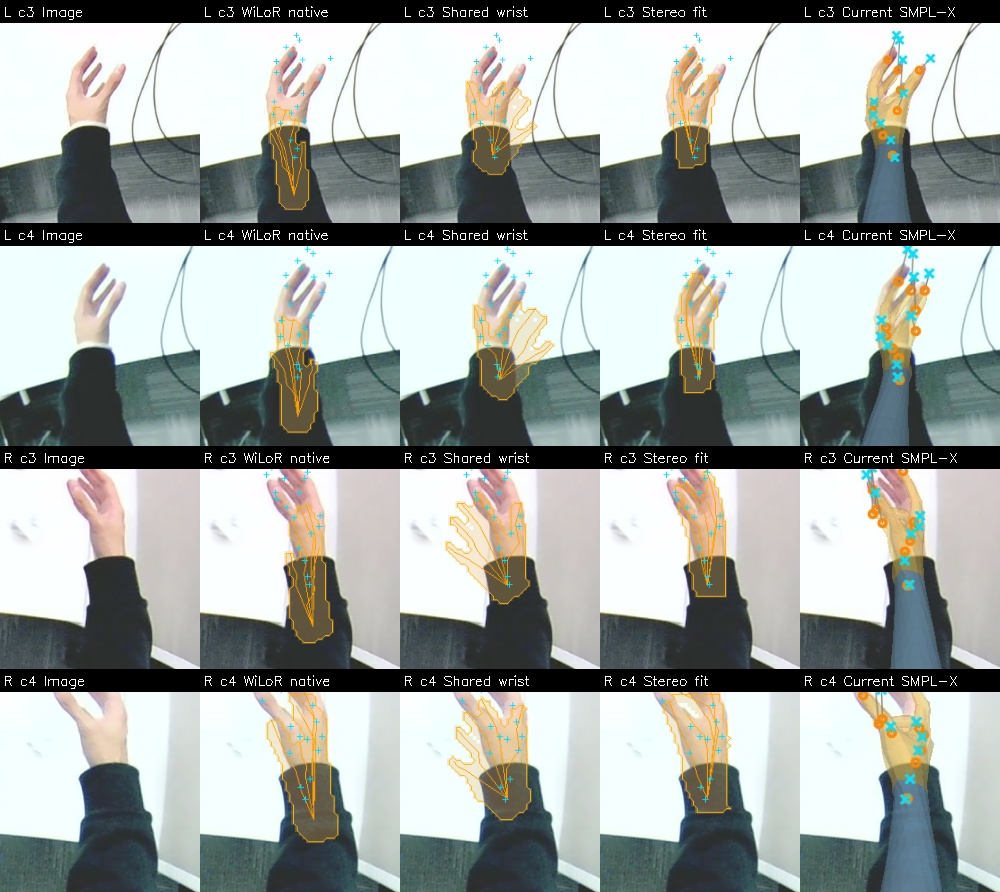
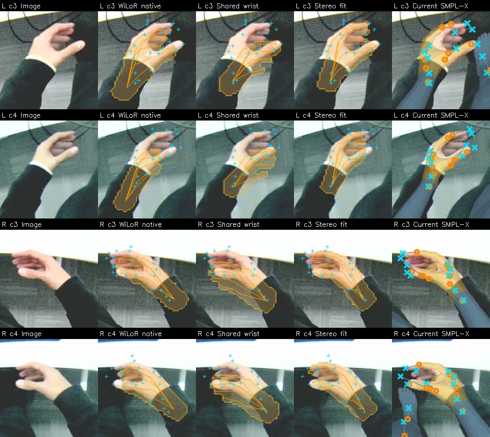

# 003、004 原生 WiLoR 与双目轮廓、指节点约束对照

每行是一只手的一眼。依次为原图、该眼原生 WiLoR MANO、共用 cam3 手形并固定到当前身体腕中心、新的双目 MANO 拟合、归档的当前 SMPL-X。前三种 MANO 投影使用金色轮廓和关节链，青色十字为自动检测；末列沿用归档图例。各列使用同一原图窗口。输入帧、原生投影与历史腕引导框回放一致。[回放差异](evidence/replay.json)

## 五个留出指尖的原图误差

数字为原图像素 RMSE，先合并两眼再开根。仅计检测坐标落在画面内的指尖，遮挡仍可能存在。每只手最多十个观测。

|片段 / 手|画内观测|WiLoR 原生|共用手形、固定腕|加双目指点与轮廓|当前 SMPL-X|
|---|---:|---:|---:|---:|---:|
|003 左|10|84.62|64.00|21.86|31.83|
|003 右|3|72.41|64.21|23.50|23.31|
|004 左|10|40.23|37.93|15.62|34.86|
|004 右|10|22.60|27.16|20.06|35.21|

004 左手最容易分辨：仅放置腕之后，指头偏到真实手的开口里；两眼的分割和指节点把手指拉回观察到的区域。其整手轮廓平均距离从原生 19.99 px 到约束后 9.25 px。004 右手的原生投影本已较近，改用共享腕和单一手形一度变差。003 右手两目合计七个指尖观测在画面外，历史汇总将这些自动外推点也计入。只看画内的三个观测，新 MANO 与当前身体手非常接近。两手 cam4 的无名指远端中间节点还出现明显跳点，具体像素位置及剔除索引见[逐手、逐眼证据](evidence/metrics.json)。

## 方法与边界

基线 fac204d。原生回放复用旧脚本的模型、左右手镜像、腕引导框、针孔相机放置与原图标定资产。用同一身体腕的双目投影恢复 cam3 米制腕位置。第二列到第三列同时改变相机放置、投影模型和两眼手形来源；该差异不能单独归因于平移或鱼眼畸变。第三列开始使用 cam3 的 WiLoR 姿态及体型，共用一份网格，使用真实标定变换投到双目。体型与腕位置固定，优化手朝向及 15 个局部旋转。双眼目标包括非指尖的 15 个关节、Sapiens2 原图分割手轮廓的近似双向边缘距离，以及相对 WiLoR 起点的旋转正则。先按画面范围及腕至指根尺度剔除离群训练点；各眼独立筛选，五个指尖均未用于优化或选姿。用同一优化目标选取步骤。已保留[筛点前的对照](evidence/all_points_control.json)。结果检验的是与自动点和图像轮廓的一致性，未使用独立人工标注或三维真值，也未验证关节生理限制。该 MANO 分支尚未移植到 SMPL-X。

历史[腕锚定实验](../2026-11-26_realvideo4_wilor_wrist/report.md)把 WiLoR 轮廓作为身体手形的额外目标，各眼的单眼手形可以彼此不一致。[掌面起点实验](../2026-11-26_realvideo4_palm/report.md)固定手指，只允许扭前臂、转腕，WiLoR 仅提供起点。它们的 A/B/C 指尖数值属于最终身体拟合，不能直接当作原生 MANO 精度。此次 003、004 的受控结果支持需要进一步调整手朝向及指姿，但两项约束和多个自由度同时改变，各自贡献尚未拆分。

复现时在仓库根目录执行本轮 replay.py（python3），然后用 bash 运行 refit.sh。首次回放因缓存目录缺失而退出，补齐目录后成功。完整参数在 outputs/wilor_stereo_fingers_20261126/。发布前检查增量、文件大小、机器路径、凭据及图像；仅发布手部派生图、源码与精简数值证据，各文件小于 50 MB。权重、数组、数据集、完整原始输出、环境文件和完整 provenance 均留在开发机。
