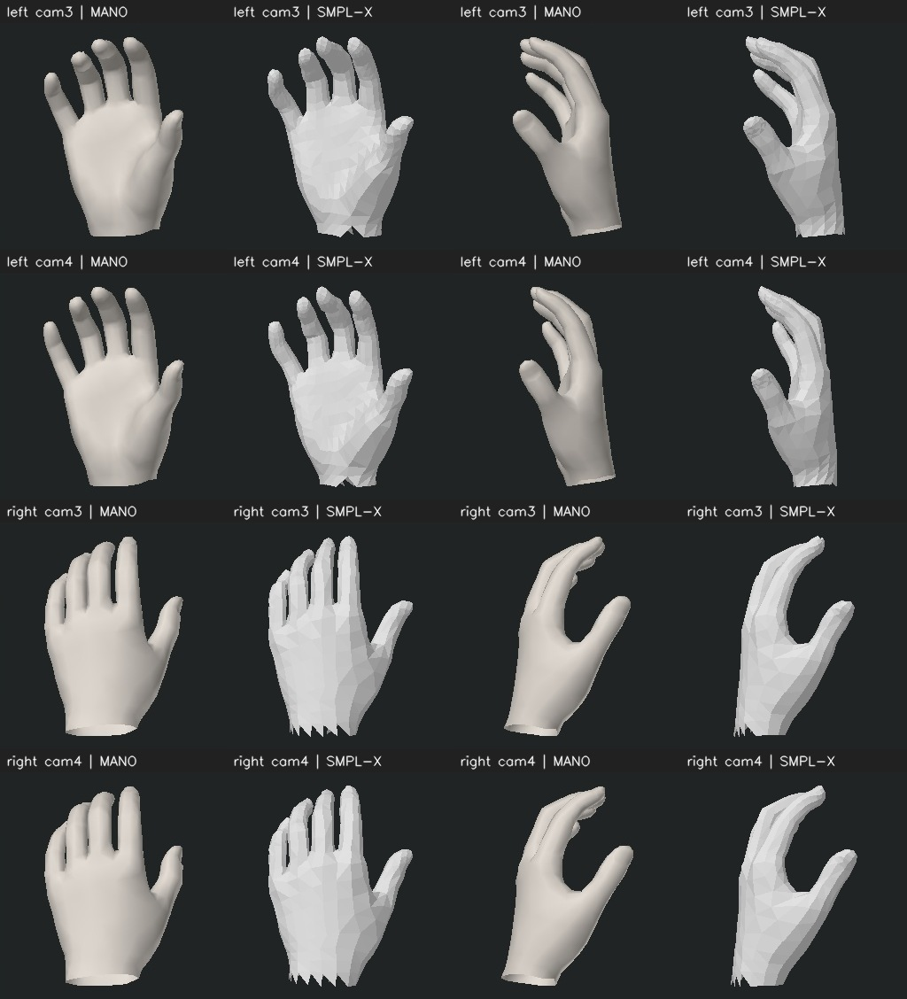
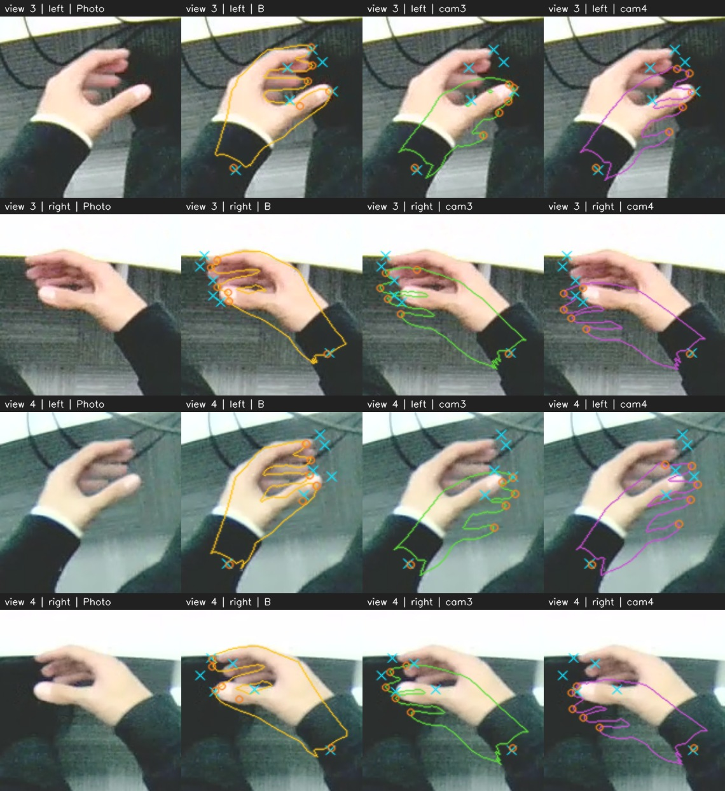

# 在 003、004 上用 WiLoR 驱动全身 SMPL-X 的手

**WiLoR 的手指弯曲可以保留在同一张全身网格上。** 004 左手在 MANO 和 SMPL-X 中都保留了拇指与四指围出的开口。但把 WiLoR 的掌向也放到已校正的手腕上，手指在原图里仍明显错位。固定同一套 WiLoR 指姿，只换成原双目 B 解的腕朝向，两段合并的留出指尖误差从 43.74 降到 30.30 px（cam3 来源），从 45.73 降到 31.94 px（cam4 来源）。[指标](evidence/summary.json) · [下载十二个全身 OBJ](https://github.com/cdh290718-oss/DownSight/releases/download/smplx-wilor-pose-transfer-20261127/hand_pose_transfer_OBJ.zip)

## 先看手形，再看它在照片里的位置

每行对应一只手和一个预测来源。相邻两列是同一手姿的原生 MANO 和全身 OBJ 手部，分别按各自掌部定向，统一观察角度、各自缩放。腕口来自选取手部三角面显示，下载的 OBJ 保留完整腕部连接。004 两眼对左手都预测出了半握形状。003 的左手更伸展，两段的张合差异随映射保留。[003 手形对照](assets/clip003_native_transfer.jpg)

每行左起是原图、原 15 关节 B、cam3 手姿映射、cam4 手姿映射。青叉为腕和画内自动检测指尖，橙圈为对应模型点。004 左手的绿色和紫色轮廓绕着近似相同的腕位置朝图像下方偏，照片里拇指与食指围成的区域更靠上。003 右手在两眼均能看到掌和指尖偏向照片里手的侧方。自动腕点本身也可能落在袖口附近；这组图没有人工标注的真实腕中心。

| 片段 | 原照片上的局部投影对照 | 同一根部视角的全身正侧面 | cam3 手姿的全图投影 | cam4 手姿的全图投影 |
|---|---|---|---|---|
| 003 | [原生腕向](assets/clip003_stereo_pure.jpg) · [沿用 B 腕向](assets/clip003_stereo_B_wrist.jpg) · [双指根校腕](assets/clip003_stereo_wrist.jpg) | [全身](assets/clip003_body.jpg) | [左目](assets/clip003_source_cam3_view_cam3.jpg) / [右目](assets/clip003_source_cam3_view_cam4.jpg) | [左目](assets/clip003_source_cam4_view_cam3.jpg) / [右目](assets/clip003_source_cam4_view_cam4.jpg) |
| 004 | [原生腕向](assets/clip004_stereo_pure.jpg) · [沿用 B 腕向](assets/clip004_stereo_B_wrist.jpg) · [双指根校腕](assets/clip004_stereo_wrist.jpg) | [全身](assets/clip004_body.jpg) | [左目](assets/clip004_source_cam3_view_cam3.jpg) / [右目](assets/clip004_source_cam3_view_cam4.jpg) | [左目](assets/clip004_source_cam4_view_cam3.jpg) / [右目](assets/clip004_source_cam4_view_cam4.jpg) |

## 哪一步造成了图上的误差

两对图、四只手共 33 个画内指尖观测。在两眼原尺寸图上计算预测指尖到自动检测点的欧氏距离，汇总所有观测后开均方根。003 右手只有 3 个画内指尖观测，单手结果受观测范围影响。B 拟合了同一检测器的非指尖关节和轮廓，各组均未使用这五个指尖作为拟合点。真实数据缺少独立三维手部真值。[003 逐眼数据](evidence/clip003.json) · [004 逐眼数据](evidence/clip004.json)

| 指姿和腕向 | cam3 提供手姿，指尖 RMSE | cam4 提供手姿，指尖 RMSE |
|---|---:|---:|
| WiLoR 指姿 + WiLoR 腕向 | 43.74 px | 45.73 px |
| 同一 WiLoR 指姿 + B 的腕向 | 30.30 px | 31.94 px |
| 同一 WiLoR 指姿 + 双目食指根、小指根校腕 | 51.29 px | 53.75 px |
| B 的指姿 + B 的腕向，双目共同拟合 | 13.32 px | 13.32 px |

最后一行两格引用同一个 B 解。各组身体前 22 个关节（含腕中心）相对 B 的最大位移为 0 mm。逐手双目腕点 RMSE 为 2.25–3.75 px。直接映射后，在掌部局部坐标系逐段比较五指共 15 段方向，cam3 和 cam4 的平均差分别为 3.31° 和 3.22°。这个数衡量映射保真度。全局掌向沿用单目预测，且原始 WiLoR 使用近似透视相机；传到真实鱼眼视图后仍要检验。[映射与几何核查](transfer.py) · [原生手的独立投影回放](../2026-11-27_wilor_native_hands/report.md)

沿用 B 腕向能单独解释一部分改善。004 左手的 cam3 指姿由 33.15 降到 17.00 px，B 仍为 12.22 px。只用双目食指根和小指根转腕时，掌面法线与双目三角化参考的平均夹角从 34.93° / 32.43° 降到 5.98° / 5.82°，整体指尖却更偏。法线和指尖检验的是不同性质，形成参考法线的两个指根也参与了这组校腕。[汇总](evidence/summary.json) · [004 沿用 B 腕向后的原图](assets/clip004_stereo_B_wrist.jpg)

## 实现与复核

每眼各自驱动整个人的左右手。取归档 WiLoR 的 15 个有效局部旋转，核对手指关节顺序、左手镜像、两模型中立掌部基底与 SMPL-X 手姿均值。在固定体型的完整 SMPL-X 上求腕相对前臂的局部旋转并前向生成网格。WiLoR 的相机平移和手形系数只用于溯源或参考，整身沿用已校正肩、肘和腕中心。校腕组只调整腕旋转；沿用 B 腕向的对照直接复用 B 已拟合的腕旋转。每只手均检查拇指所在一侧、有效旋转回算、身体关节位移；网格导出后回读顶点与拓扑，再做投影。[输入与原生模板](source.py) · [参数映射](transfer.py) · [渲染与 OBJ 校验](visuals.py)

OBJ 均以左相机 cam3 为坐标系，单位米。每段每个来源包含三个文件版本，裸 cam3/cam4 表示直接映射，后缀 wrist 表示双指根校腕，B_wrist 表示沿用已有 B 腕向。B 基线 OBJ 另见[上轮报告](../2026-11-27_smplx_stereo_fingers/report.md)。在这两帧上，双目腕向与 WiLoR 指姿适合作为后续弱调整候选。手部轮廓能否进一步帮助肩肘或腕中心定位，需要另做允许身体移动的实验。

执行基线与运行时 HEAD 均为 39555f64c7db7267e553cc46844baaab12a98f47。工作树有无关改动，本轮增量仅包含本 run；使用已归档的输入、标定、姿态和外部手、身模型。公开执行记录使用仓库相对路径；原始帧、权重、模型数组、完整本地输出和日志留开发机。发布前核对工作区、暂存和待推提交、远端、单文件小于 50 MB、图片与附件指纹、敏感路径和凭据。Git 仅存派生图、脚本、报告和精简证据，Release 提供全身 OBJ。[执行记录](evidence/execution.json) · [图像指纹](evidence/results.json) · [OBJ 指纹](evidence/attachment_audit.json) · [推送前检查](evidence/prepush.json)
