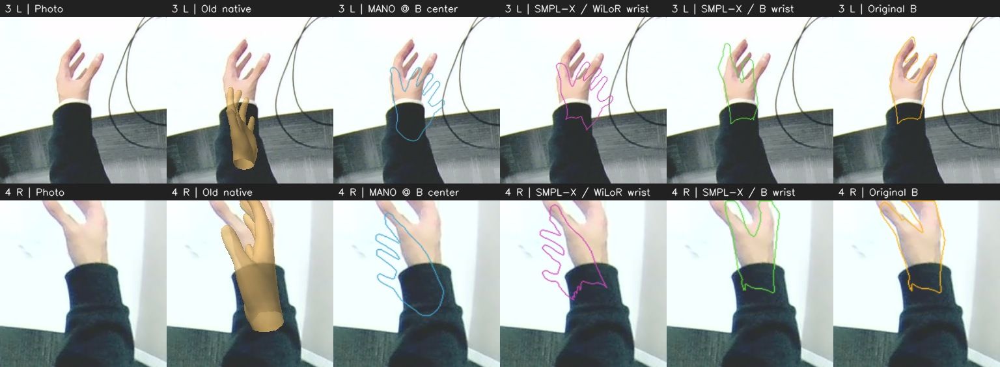

# 为什么两张图里的 WiLoR 手看起来不一样

**003 左手的小指在旧 WiLoR 原生预测里已经比较直。** 小指近端指间关节（PIP）的屈曲角在旧 MANO 中是 15.0°，同一套指姿转到全身 SMPL-X 后是 14.7°，原双目 B 解是 65.1°。换成 B 的腕朝向，小指屈曲仍是 14.7°，但手指在图像中的落点明显变化。[同掌部视角看手形](assets/clip003_shape.jpg) · [逐手关节和投影数值](evidence/results.json)

上排是 003 左手在 cam3，下排是右手在 cam4。依次看原图、旧图集原生投影、放到 B 腕中心的 MANO、同中心同来源腕向的 SMPL-X、只把腕向换为 B 的 SMPL-X、完整 B。**中间看蓝线和紫线**，可以看出换手模型以后，手指朝向相近。**再看紫线和绿线**，这两列的 SMPL-X 指姿参数逐项相同，腕旋转使轮廓移向照片里的手。004 左手的拇指和四指围出的半握开口在两个手模型中都能看到。[004 同样对照](assets/clip004_source.jpg)

## 两个版本的原生 WiLoR

旧图集直接用鱼眼原图和 Sapiens2 腕点引导的手框；ViDiHand2 对照里的 WiLoR 使用透视图和自己的检测框。下图对两次原生输出使用同一套骨架画法、同一张鱼眼照片和同一裁切。两帧共 33 个画内自动指尖观测，旧版逐眼原生投影的 RMSE 为 **57.37 px**，新版逐眼原生投影为 **15.41 px**。两项输入同时改变，各自贡献仍需单独消融。两眼此处各自预测，所以这一组只评价单眼投回照片的表现。[003 原生对原生](assets/clip003_inputs.jpg) · [004 原生对原生](assets/clip004_inputs.jpg) · [新版输入和投影方法](../2026-11-27_vidihand2_comparison/report.md)

## 同一份旧预测，固定身体和腕中心

两段均沿用先前逐手选定的来源，人物左手来自 cam3，右手来自 cam4。下表每一列的同一只三维手都同时投向两个相机。表中的误差为原尺寸像素下、对相同画内自动指尖的二维欧氏距离 RMSE。汇总按观测数量计算。B 已使用非指尖点和轮廓拟合，这些自动指尖与拟合点来自同一检测器。真实场景缺少独立的三维指关节真值。

| 人物的手 | 指尖观测数 | MANO 放到 B 腕中心 | SMPL-X 用 WiLoR 腕向 | 相同指姿换 B 腕向 | 完整 B |
|---|---:|---:|---:|---:|---:|
| 003 左 | 10 | 64.00 | 59.05 | 40.36 | 13.95 |
| 003 右 | 3 | 63.48 | 59.30 | 30.88 | 16.84 |
| 004 左 | 10 | 37.93 | 33.06 | 17.00 | 12.23 |
| 004 右 | 10 | 38.96 | 33.49 | 18.46 | 12.51 |
| 合并 | 33 | **50.04** | **45.25** | **27.77** | **13.32** |

四只手按各自掌部坐标比较，WiLoR 腕向下，SMPL-X 与 MANO 的 15 段手指方向平均差逐手为 2.46°、3.75°、2.58°、4.17°。003 左手换 B 腕向时，按腕到中指根方向及两侧指根构造的掌部坐标，其法线相对原生 MANO 改变约 50.9°。这解释了原图中很大的轮廓变化。同一只手再从绿色换到完整 B，指尖误差从 40.36 降至 13.95 px，指姿差异仍很明显。003 右手只有三个画内指尖可测。

| 片段 | 选中来源的逐步对照 | 左右目上的同一只手 | 两个相同掌部观察角度 | 全身 OBJ 正侧面 |
|---|---|---|---|---|
| 003 | [逐步对照](assets/clip003_source.jpg) | [双目](assets/clip003_stereo.jpg) | [手形](assets/clip003_shape.jpg) | [全身](assets/clip003_body.jpg) |
| 004 | [逐步对照](assets/clip004_source.jpg) | [双目](assets/clip004_stereo.jpg) | [手形](assets/clip004_shape.jpg) | [全身](assets/clip004_body.jpg) |

## 核验

执行基线及运行时 HEAD 为 9e01c57fe9c2d845852d6a4a97b7f08c2b983b55，工作树有既存无关改动。归档旧图的照片、相机、选中预测、B 姿态及衍生图均核对指纹。源相机对照第二列直接取自已验证的旧图，从第二列到第三列同时引入 B 腕中心和真实鱼眼投影。独立 MANO 手只渲染双手，后续 SMPL-X 用全身网格处理自遮挡。手形图复用旧映射实验已验证的掌部视角，分别居中并缩放。全身和后续照片轮廓均回读本轮 OBJ 后绘制。

本轮从参数恢复 MANO 后，相对原 GPU 关节的最大偏差低于 0.052 mm。各全身方案的身体与腕中心最大位移为 0 mm；绿色方案的姿态数组逐项复现上一轮逐手选中的结果。按左右手合成后，原生腕向方案与先前由单一相机驱动双手的整身方案，关节投影最大相差 0.387 px，表中使用本轮合成后重新计算的投影。复现命令为从仓库根目录运行 `bash runs/2026-11-27_native_hand_wrist_views/run.sh`，需要已归档的模型和数据。[手网格回放](evidence/mano_replay_mm.json) · [逐手误差及 OBJ 指纹](evidence/results.json) · [执行记录](evidence/execution.json)

发布范围为本轮派生 JPEG、脚本、报告、脱敏证据。逐项核对工作区、暂存、待推提交与远端。单文件小于 50 MB，排查凭据、本机路径、原始帧、视频、模型数组、网格文件和权重。公开路径使用仓库相对位置，完整日志与 OBJ 留在开发机。[增量发布检查](evidence/prepush.json)
