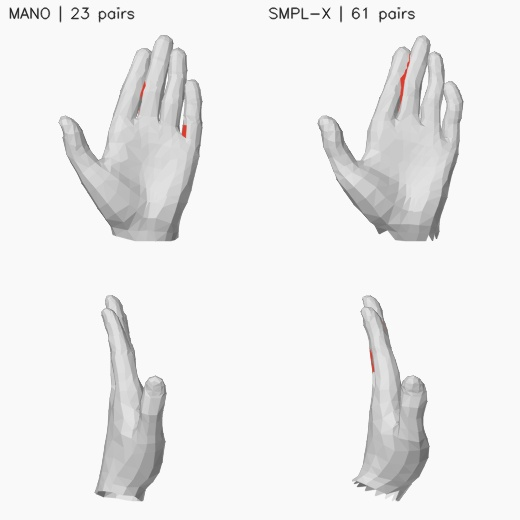
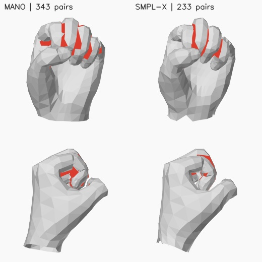
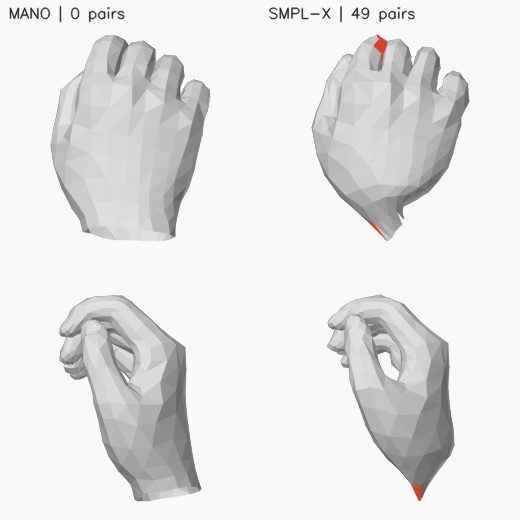
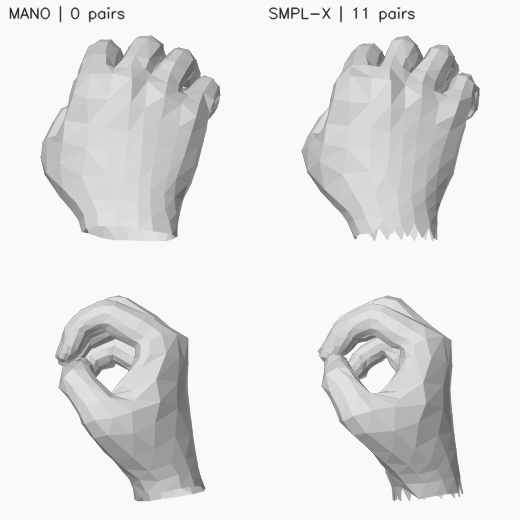

# WiLoR 原生手与迁移后的自交，及腕旋转的刚体对照

200 对共 400 只手。逐手重放 v5 采用的 280 个 WiLoR 候选，保留同一图像、人物手别、检测框选择和模型权重。逐一校验归档文件哈希、15 个指关节旋转矩阵、同体型静止手关节与投影像素，三项数值的最大差均为零。另 120 只按原规则保留 v4，此前复核均无自交。[重放记录](evidence/replay.json)

| 原生 MANO | v5 SMPL-X 无自交 | v5 SMPL-X 有自交 |
|---|---:|---:|
| 无自交 | 75 | 3 |
| 有自交 | 75 | 127 |

最终自交的 130 只手中，127 只在原生输出里已经自交。两模型都自交的手中，按各自网格主导蒙皮权重粗分掌部和五指，117 只至少有一个相同区域组合。两者网格拓扑不同，面片对数不能直接衡量穿入深度，也不能认定是同一处交叉。同体型、单位关节旋转的原生 MANO 对照中，0 只存在自交；施加预测姿态后有 202 只出现该手静止网格中没有的相交面片对。[逐手比较](evidence/native.json)

原生无自交到最终有自交的三例是 val072 右手、val155 右手、val166 左手。只迁移指姿时分别为 33、0、29 对相交面；最终为 49、11、34 对。val155 需要结合最终腕姿才能复现这次交叉。另有 75 只在原生网格自交而最终无自交。

## 原生 MANO 和最终 SMPL-X

左列为原生输出，右列为最终手。每列按各自掌部骨架取两个相差 90° 的局部视角，独立居中缩放以方便观察。红面参与严格三角相交。数字是同一网格内相交的面片对数。两张图展示原生已有，另两张图展示最终新增。

### val001_left



### val184_left



### val072_right



### val155_right



## 为什么只改腕关节也会自交？

对先前仅更换腕关节参数就自交的 10 只手，保持手指局部旋转不变，比较五次前向几何。整体刚体对照将全部 v4 手顶点绕腕中心乘以同一个实际腕旋转差。SMPL-X 的皮肤则按每个顶点的骨骼权重混合多个变换，同时用姿态相关偏移修正网格。用原实现的骨骼变换矩阵与姿态偏移分开重建，核对完整顶点误差小于 0.002 mm。下表中的“仅”指另一项保留 v4 值。

| 对照 | 自交手数（共 10 只） | 相交面片对合计 |
|---|---:|---:|
| v4 原手 | 0 | 0 |
| 整只手施加严格刚体变换 | 0 | 0 |
| 仅更新骨骼变换，按原顶点权重混合 | 10 | 65 |
| 仅更新姿态相关形状偏移 | 0 | 0 |
| SMPL-X 完整腕更新 | 10 | 67 |

全部 67 对在近似解剖分区中均落于掌部–掌部。相关顶点距腕中心约 3–33 mm，腕及手指骨骼链以外的蒙皮权重约为 24%–59%。各点受到上游骨骼和转动手腕的影响比例不同，掌根皮肤发生局部变形。仅更新混合骨骼变换就足以在十例全部产生自交；姿态相关偏移也能改变面片对数。这里的权重始终固定。[逐例分解及位置范围](evidence/wrist.json)

## 运行与核查

执行基线 fe16f83，加本目录脚本及既有无关工作树改动。沿用验证集的严格三角相交检查，排除共享顶点面片。原生采用预测体型与姿态的 MANO 输出顶点，左手按原协议镜像，SMPL-X 采用此前核验的同侧手分区。计算在开发机使用既有受限模型、权重与冻结输入。公开数据仅含派生指标、代码、标记后的渲染。核查工作区、暂存、待推提交和远端，排除权重、数组、完整日志、开发机路径与凭据，单文件小于 50 MB。[执行记录](evidence/execution.json)

```sh
r=runs/2026-11-27_native_mano_audit
python -B "$r/launch.py" predict_new
python -B "$r/launch.py" measure native
python -B "$r/launch.py" measure wrist
python -B "$r/launch.py" gallery
```
