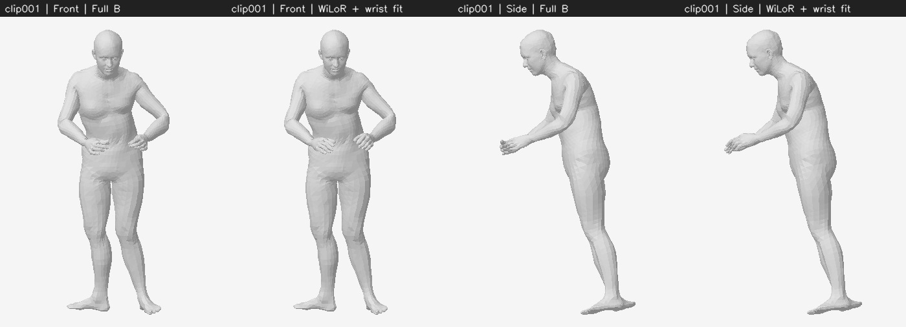
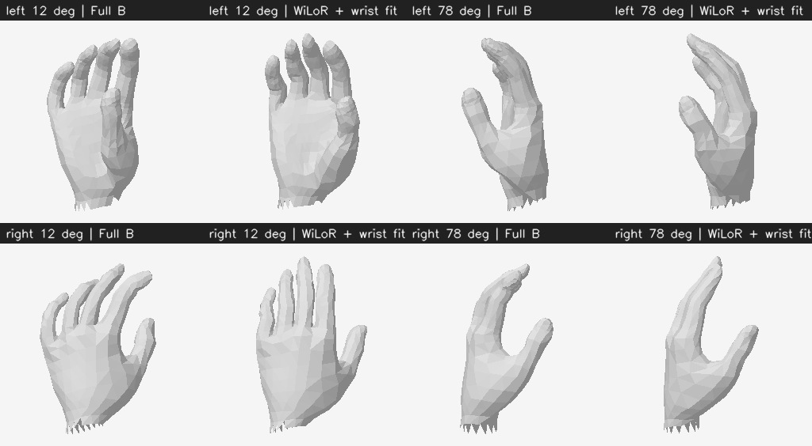
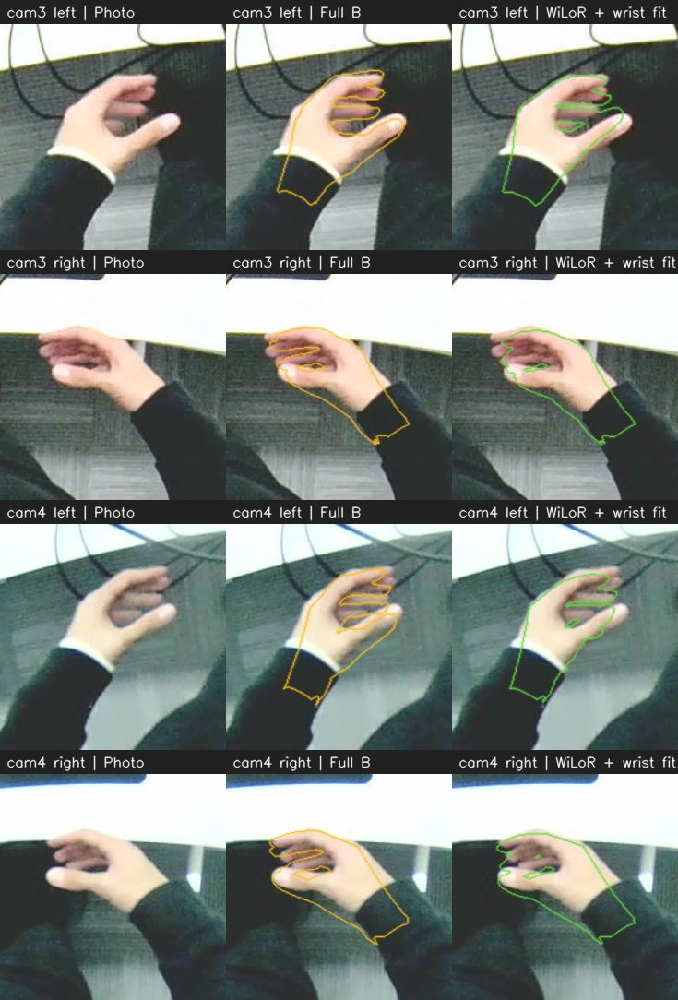

# 真实双目四帧的全身与手部渲染：完整 B 和 WiLoR 固定指姿只转腕

**先看 001 和 004。** 001 两种解的全身站姿一致，右手侧看时，WiLoR 的四指更伸直，B 的指尖向掌内弯。004 左手两种解都有拇指和四指围出的半握开口，原图里两套轮廓都能跟到拇指附近。全身图依次为 B 正面、WiLoR 正面、B 侧面、WiLoR 侧面；相邻两幅共用镜头、尺度和中心。

| 真实片段 | 全身 OBJ 正侧面 | 左右手 OBJ 放大 | 双目原图手部放大 | 原尺寸全身网格叠加 |
|---|---|---|---|---|
| 001 · 本轮新增对照 | [全身](assets/clip001_body.jpg) | [双手](assets/clip001_hands.jpg) | [原图、B、WiLoR](assets/clip001_photo.jpg) | [cam3](assets/clip001_cam3.jpg) / [cam4](assets/clip001_cam4.jpg) |
| 002 · 本轮新增对照 | [全身](assets/clip002_body.jpg) | [双手](assets/clip002_hands.jpg) | [原图、B、WiLoR](assets/clip002_photo.jpg) | [cam3](assets/clip002_cam3.jpg) / [cam4](assets/clip002_cam4.jpg) |
| 003 · 前轮中心帧 | [全身](assets/clip003_body.jpg) | [双手](assets/clip003_hands.jpg) | [原图、B、WiLoR](assets/clip003_photo.jpg) | [cam3](assets/clip003_cam3.jpg) / [cam4](assets/clip003_cam4.jpg) |
| 004 · 前轮中心帧 | [全身](assets/clip004_body.jpg) | [双手](assets/clip004_hands.jpg) | [原图、B、WiLoR](assets/clip004_photo.jpg) | [cam3](assets/clip004_cam3.jpg) / [cam4](assets/clip004_cam4.jpg) |

双手立体图上排为人物左手，下排为右手；每排先看第一角度的 B、WiLoR，再看第二角度的 B、WiLoR。两个方案使用相同的掌部观察坐标，保留腕向差异。腕端边缘来自截取手部三角面。原图放大每排由左到右为照片、B 的黄线、WiLoR 的绿线，裁切与缩放相同。立体渲染和双目投影都从相应的全身 OBJ 导出、回读后生成。

## 图上有哪些差别

002 左手在立体近景里，B 的拇指横过掌前，WiLoR 的拇指弯向食指一侧；两者手掌都位于手腕上方，细看指形差别更明显。003 左手在 cam3 的绿色拇指外缘偏离照片手指，B 的轮廓更贴近。003 右手部分手指出画，双目加起来只有三个指尖可做数值对照。[002 手形](assets/clip002_hands.jpg) · [003 原图放大](assets/clip003_photo.jpg)

## 留出指尖的二维误差

| 配对组 | 画内指尖观测数 | 完整 B，px | 固定透视 WiLoR 指姿、只转腕，px |
|---|---:|---:|---:|
| 新增对照 001、002 | 40 | 15.48 | 17.89 |
| 复核 003、004 | 33 | 13.32 | 17.23 |

指标为两眼原分辨率下，重投影与画内自动指尖之间的欧氏距离 RMSE。每只手的五个指尖从点位损失和候选评分中留出，B 的轮廓仍包含可见指端。两组中 B 均更贴自动指尖。四帧只有二维自动参照，三维手姿自然度和端到端速度仍待独立检验。[逐手误差、有效点数、来源及图像指纹](evidence/results.json)

## 两组如何得到

同一帧，两组共用双目鱼眼标定、SMPL-X 体型、肩肘姿态和起始腕中心。001、002 使用各自归档的 v4 掌面细化身体起点，本轮用完整 B 协议重算基线。003、004 沿用归档紫线身体、肩肘校正后的同帧起点，复用先前的完整 B。两批起点的上游处理有区别，因此表格按批报告。四帧两组相对各自起点，前 22 个身体关节（含双腕中心）最大位移为 0 mm。[001 的 B](evidence/clip001_B.json) · [002 的 B](evidence/clip002_B.json) · [此前 003、004 的 B](../2026-11-27_smplx_stereo_fingers/report.md)

- **完整 B** 让腕和指节一起移动，以筛选过的双目非指尖关节、分割轮廓及旋转正则拟合，70 步 Adam。
- **只转腕** 使用 640 × 480 虚拟透视图上 WiLoR 自检框的指姿。新两帧逐眼实际推理，复核两帧沿用相同输入方案的归档预测。每只手将每眼的 15 个局部指节旋转映射到 SMPL-X 后固定，只求相对前臂的一个三维腕旋转。用最多 15 个非指尖关节和起始腕向的软约束求解；按双目非指尖重投影分数逐手选来源，合并两只手再前向生成一份全身网格并评测。八只手均有来自两眼的候选。[新两帧的检测与指姿指纹](evidence/predictions.json) · [拟合与渲染](experiment.py)

执行基线与运行时 HEAD 均为 b8140a4d5f85ab3d2d6c0c3c992ee1d295a76362。执行时工作树有无关既存改动。复现时从仓库根目录依次执行本目录的 `python3 -B <RUN>/launch.py predict_new`、`python3 -B <RUN>/launch.py experiment baseline`、`python3 -B <RUN>/launch.py experiment gallery`。归档模型与本地相机、姿态和观测按指纹读取。执行记录保留开发中索引失败和修正；公开路径以仓库相对路径及占位符表示。[执行记录](evidence/execution.json)

发布前检查了工作区、暂存、待推增量和远端。发布本轮代码、派生 JPEG、报告、脱敏证据；完整 OBJ、原始图、视频、模型参数数组和权重留在开发机。检查单文件大小、图像格式与元数据、本机路径及敏感信息。[增量自检](evidence/prepush.json)
