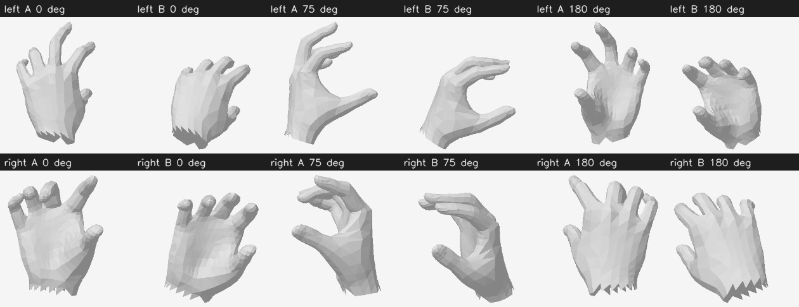

# 003、004 全身 SMPL-X 手部的双目指节点对照

从紫线身体和已校正的肩肘出发，用 15 个非指尖关节拟合整只手，四只手的画内留出指尖 RMSE 均下降。两眼共 33 个观测，四指根 A 为 33.17 px，十五关节 B 为 13.32 px，同口径的上轮独立 MANO 为 19.77 px。B 的结果直接来自全身 SMPL-X，两段的身体主关节与腕中心对共同起点的最大位移均为 0 mm。建议把 B 用作下一批帧的手部候选；两帧均来自同一套相机，指标为相对自动检测的二维一致性。[汇总和逐指数值](evidence/metrics.json) · [下载 A、B 四个全身 OBJ（cam3，单位米）](https://github.com/cdh290718-oss/DownSight/releases/download/smplx-stereo-fingers-ab-20261127/stereo_fingers_AB_OBJ.zip)

## 同一批留出指尖

| 片段与手 | 画内指尖观测 | A 四指根（px） | B 十五关节（px） | 独立 MANO 参考（px） |
|---|---:|---:|---:|---:|
| 003 左 | 10 | 31.83 | 13.95 | 21.86 |
| 003 右 | 3 | 23.31 | 16.84 | 23.50 |
| 004 左 | 10 | 34.86 | 12.22 | 15.62 |
| 004 右 | 10 | 35.21 | 12.51 | 20.06 |
| 合并 | 33 | 33.17 | 13.32 | 19.77 |

合并时累积各画内观测的像素欧氏距离平方，再开均方根。003 右手的食、中、无名指尖都没有画内检测，表中这只手只能检验部分手指。与手部分割的双向轮廓距离按手和眼平均从 6.34 降到 5.59 px，四只手中有三只改善。独立 MANO 使用自身手形、初值和优化协议，该列只提供同帧参照。[上轮 MANO 对照](../2026-11-26_wilor_stereo_fingers/report.md)

## 004 左手的网格变化

原图里拇指和另外四指之间留有开口。原 A 中指突出，斜侧视能看到一根手指显著高出邻指；B 中这几根手指弯曲后聚到相近高度，拇指侧仍留有开口。两眼合并中指尖偏差从 50.49 降到 13.92 px，拇指尖也从 14.24 降到 10.95 px。手轮廓距离从 8.05 降到 6.58 px。004 右手中指尖从 53.22 降到 12.61 px，但原先较准的拇指尖从 7.41 增到 9.65 px，手轮廓从 5.87 增到 6.28 px。画面内也可能有遮挡，无独立人工标注及三维手形真值。[004 逐眼拟合与筛点](evidence/clip004.json)

| 片段 | 左右目手部原图、A 与 B | 局部 OBJ 三个方向 | B 全身双目网格及关节点 | 全身 OBJ 正侧面 A/B |
|---|---|---|---|---|
| 003 | [双目手部](assets/clip003_stereo_hands.jpg) | [手形](assets/clip003_mesh_hands.jpg) | [cam3](assets/clip003_cam3.jpg) / [cam4](assets/clip003_cam4.jpg) | [正侧面](assets/clip003_body.jpg) |
| 004 | [双目手部](assets/clip004_stereo_hands.jpg) | [手形](assets/clip004_mesh_hands.jpg) | [cam3](assets/clip004_cam3.jpg) / [cam4](assets/clip004_cam4.jpg) | [正侧面](assets/clip004_body.jpg) |

手部原图对照从左到右为原图、A、B。黄绿轮廓分别对应 A 和 B 的可见手网格，青叉表示画内自动指尖，橙圈为对应的模型指尖。局部 OBJ 视图使用同侧 A 掌部坐标定向，每个角度下两组共用中心和比例。腕端锯齿来自渲染时截取手部三角面的边界；压缩包内是完整人体网格。

## 控制变量与核查

基线及运行时 HEAD 为 23de98076f242ce034ef83d631d9ff12ac5536bb。两组从已归档肩肘校正姿态分别起步，不使用 WiLoR 指姿初始化。A 复算四个非拇指指根，B 使用五指各三个关节，包含拇指近端。B 对每眼独立使用上轮的画内和腕至指根尺度筛选，逐个索引核对通过。每只手对有效点的鲁棒损失取均值，再用同一只手原有的可靠性权重聚合；两组共用点项总系数。真实鱼眼、原图分割轮廓、手腕和指姿正则、局部转角上限、Adam 步长及 70 步预算一致。腕可转动，位置固定。起点与每步按本组损失选取，五个指尖全程不进点位损失和选姿。B 同时更换点集合及应用已定义的筛选，无法由此分离其中单一关节的贡献。A 重算的投影与历史 A 的腕、指根、指尖输出逐点一致。[003 逐眼证据](evidence/clip003.json) · [004 逐眼证据](evidence/clip004.json) · [优化代码](compare_fit.py)

## 执行与发布

工作树有无关既存改动，本轮仅提交此 run 的文件。首次计算在输入预检处因旧报告以单精度保存检测点、原始检测保留更高精度而退出；按旧报告的实际存储精度复核，重跑两帧通过。导出的 OBJ 已回读核对顶点与面索引，压缩包核对全部四个文件。推送前检查工作区、暂存、待推增量、远端状态；增量不含权重、原始视频和图片文件、数组、机器绝对路径、凭据或完整本地日志。单文件小于 50 MB，公开图像仅含请求的派生可视化，Release 提供拟合网格。[执行记录](evidence/execution.json) · [附件哈希](evidence/attachment_audit.json) · [增量自检](evidence/prepush.json)
