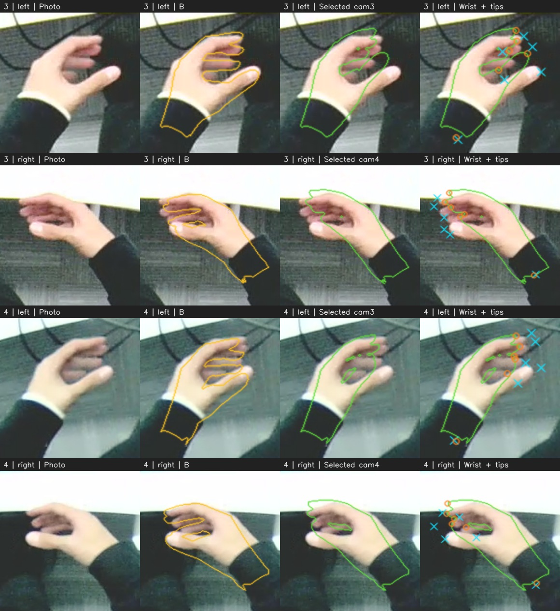

# 003、004 的双目共享手姿

两段均由双目评分选出人物左手的 cam3 指姿、右手的 cam4 指姿。每段生成一份全身 SMPL-X OBJ，并用这份网格投回两眼。沿用 B 的体型、身体和腕朝向，两个手腕中心的三维位移均为 0 mm。[逐手选择](evidence/selection.json) · [下载两份全身 OBJ，cam3 坐标系，单位米](https://github.com/cdh290718-oss/DownSight/releases/download/stereo-wilor-selected-hands-20261127/stereo_selected_hands_OBJ.zip)

| 片段 | 原尺寸网格投影 | 网格与手部点叠加 | 全身 OBJ 渲染 | 双手放大 |
|---|---|---|---|---|
| 003 | [左目](assets/clip003_cam3.jpg) / [右目](assets/clip003_cam4.jpg) | [左目](assets/clip003_cam3_points.jpg) / [右目](assets/clip003_cam4_points.jpg) | [正面、侧面](assets/clip003_body.jpg) | [原图上的手](assets/clip003_hands.jpg) / [OBJ 局部两个角度](assets/clip003_hand_OBJ.jpg) |
| 004 | [左目](assets/clip004_cam3.jpg) / [右目](assets/clip004_cam4.jpg) | [左目](assets/clip004_cam3_points.jpg) / [右目](assets/clip004_cam4_points.jpg) | [正面、侧面](assets/clip004_body.jpg) | [原图上的手](assets/clip004_hands.jpg) / [OBJ 局部两个角度](assets/clip004_hand_OBJ.jpg) |

原图放大图每行从左到右依次是照片、B 的可见轮廓（黄）、选中手姿的可见轮廓（绿）、绿色轮廓加腕与指尖。青叉为自动检测点，橙圈为模型投影。行首 3、4 表示正在看的相机，Selected 后的 cam3 或 cam4 表示指姿来自哪一眼。手部 OBJ 视图在相同掌部参考轴和缩放下比较 B 与选中指姿；腕口来自渲染时截取手部面片，下载文件是连续的全身网格。

## 与 B 及固定来源的差距

| 片段 | 人物手 | 左目 / 右目有效评分点数 | cam3 / cam4 候选分数 ↓ | 选中来源 | 选中指尖 RMSE | B 指尖 RMSE | 画内指尖数 |
|---|---|---:|---:|---|---:|---:|---:|
| 003 | 左 | 15 / 14 | 6.184 / 6.432 | cam3 | 40.36 px | 13.95 px | 10 |
| 003 | 右 | 13 / 10 | 5.936 / 5.140 | cam4 | 30.88 px | 16.84 px | 3 |
| 004 | 左 | 15 / 15 | 5.354 / 6.116 | cam3 | 17.00 px | 12.22 px | 10 |
| 004 | 右 | 15 / 15 | 5.269 / 5.067 | cam4 | 18.46 px | 12.51 px | 10 |

两段合计 33 个画内自动指尖。先累积每个观测的二维欧氏距离平方，再开均方根。全部用 cam3 为 30.30 px，全部用 cam4 为 31.94 px，逐手选择为 **27.77 px**，原 B 双目拟合为 **13.32 px**。四只手中，按非指尖分数选中的候选，恰好也是两个候选中指尖误差较低的。003 左手是剩余误差最大的例子，选中手在 OBJ 中的手指明显比 B 更伸展。004 左手仍保留半握开口。[两段逐手投影与核验](evidence/metrics.json) · [003 手形渲染](assets/clip003_hand_OBJ.jpg) · [004 手形渲染](assets/clip004_hand_OBJ.jpg)

## 选择与验证

对每只手，cam3 和 cam4 各提供一套已映射到 SMPL-X 的 15 个局部指节旋转。两个候选放到同一个 B 腕上，均投回两眼。评分沿用 B 的手指非指尖关节索引以及画内和腕距筛选。对每个有效点取投影像素距离 d，计算 2 × (√(1 + (d/6)²) − 1)，在每眼内平均后，两眼等权平均。选择分数较小的整套指姿。只拷贝选中一侧的手指旋转，左右手装入同一 SMPL-X 参数后重新前向、重新投影。核对腕旋转逐元素相等、身体关节位移和合并前后的手点投影。[选择及重新前向](choose.py)

评分未使用指尖、轮廓或人工点。这是对上一轮已看过结果的两帧进行回顾性验证，画内自动点可能受遮挡影响，003 右手只有三个指尖观测。误差衡量与自动检测的二维一致性。缺少真实三维手姿，且这两帧的选择不能推断其他帧固定按左手 cam3、右手 cam4 即可。[上一轮候选对照](../2026-11-27_hand_pose_transfer/report.md)

## 执行与发布

运行基线和执行时 HEAD 均为 1961fa4f69cd63dcd5088f7a7d774065cc3e54ca。工作树有既存无关改动，本轮仅暂存此 run。输入为上轮的 B_wrist 候选、B 姿态和标定后的真实鱼眼原图；使用归档哈希复核姿态、原图与标定。每段将最终 OBJ 回读，验证顶点和面索引，再渲染全身、局部和双目投影。首次渲染遇到同名模块导入错误，按明确文件路径载入既有渲染器后成功。检视图像后收紧手部放大图的取景窗口，评分和误差一直使用原始坐标。[渲染脚本](render_selection.py) · [执行记录](evidence/execution.json) · [派生图片指纹](evidence/results.json)

发布前核验工作区、暂存内容、待推增量、远端状态和单文件大小上限。增量包含图集、代码和脱敏证据，无权重、数据数组、视频、原始帧、凭据、机器绝对路径和完整本地输出。两份全身网格通过 Release 提供。[推送前检查](evidence/prepush.json) · [附件指纹](evidence/attachment_audit.json)
