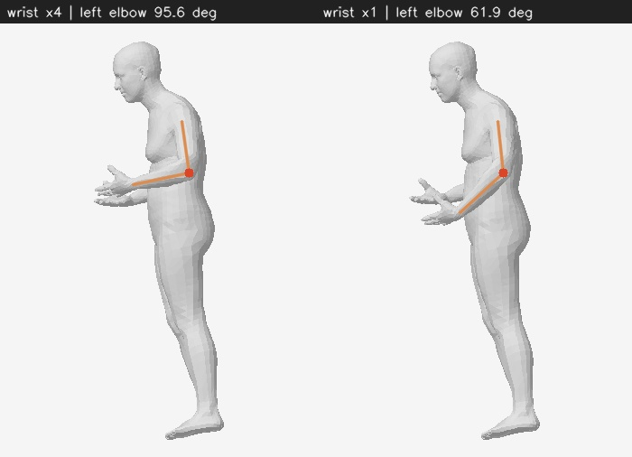

# 003 第四对 · 腕肘同权的最终 v5 网格

左肘在同权下明显打开，贴近自动肘点，同时左腕与五指尖的投影变差。右臂的变化较小。样本按上轮肘角敏感性选取，仅代表该帧。缺少独立三维肘角真值。

|手臂与腕权重（肘权重均为 1）|屈曲角（°）|肘 RMSE（px）|腕 RMSE（px）|留出指尖 RMSE（px）|手部候选|
|---|---:|---:|---:|---:|---|
|左，4|95.62|8.37|3.31|9.82|cam4|
|左，1|61.87|4.24|12.33|42.36|cam4|
|右，4|89.76|6.54|1.17|22.99|cam3|
|右，1|91.52|5.69|2.59|19.47|cam3|

同一对双目观测、同一掌面起点和紫线平移。仅改变肩肘校正中的腕点权重，两组均重新执行逐手 WiLoR 候选选择和双目转腕。屈曲角以直臂为零度，二维误差按该手两眼有效的自动检测点合并计算，单位为原图像素。最终手部阶段对身体主关节的影响通过原 v5 漂移阈值检查。原权重最终姿态参数逐值复现已归档 v5。两个 OBJ 均经顶点、拓扑回读核对。[逐手角度、逐眼距离、候选和 OBJ 哈希](evidence/results.json) · [源帧双目叠加](../2026-11-27_video34_uniform_v5/assets/v003_04_both.jpg)

执行基线 50fa3d547c4c8241fc18cac32ae6d71343ae59fc。复现命令为仓库根目录下的 `bash runs/2026-11-27_v003_04_equal_wrist/run.sh`。同权 OBJ 和最终参数保存在仓库输出目录。完整模型、输入缓存和原始网格留在开发机。本次是单帧对照，正式 v5 配置未改动。

推送前核对工作区与暂存增量，检查文件类型、大小、路径与常见凭据标记。发布实验脚本、文档、精简数值和无原始人物影像的网格渲染。单文件小于 50 MB，无权重、数据集、视频、数组、环境文件、完整原始输出、完整 provenance 或 patch。
