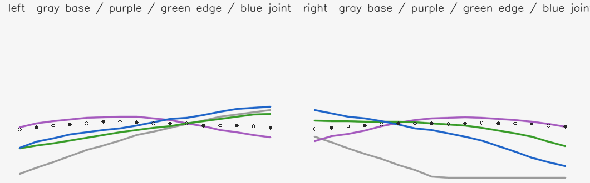
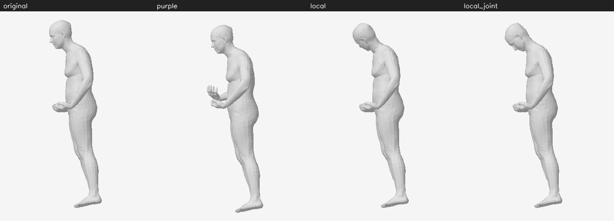

# Video 003 第 4 对 · 放开头随上胸

放开颈和头的局部旋转以后，模型可以在保持肩、肘、腕位置的同时改善脸缘。但在这对图和本轮角度范围内，局部旋转的脸缘和嘴角都比紫线全身平移偏得更多。结果支持“头随上胸限制了局部补偿”，尚不能确定脸部偏差来自头颈姿态还是相机相对头部的佩戴位置。

## 同帧对照

使用 Video 003 第 4 对 cam3/cam4、同一掌面起点、鱼眼标定与肩肘求解器，腕与肘同权。第一项是原身体位置上的同权肩肘结果。紫线项先使用归档全身平移，再以同样权重校正肩肘。两项局部试验均从第一项出发，根节点、肩肘和腕指全部冻结。指标取双目原图像素。脸缘按两眼各 8 个留出列的纵坐标求 MAE，嘴角按每眼近侧嘴角求二维欧氏 RMSE。

| 条件 | 留出脸缘 MAE，px | 嘴角 RMSE，px | 肘 / 腕 RMSE，px | 左 / 右肘屈曲，° |
| --- | ---: | ---: | ---: | ---: |
| 原身体位置，头随胸 | 70.3 | 254.5 | 4.76 / 10.62 | 53.1 / 60.4 |
| 紫线全身平移，头随胸 | 9.9 | 34.2 | 5.01 / 8.91 | 61.9 / 91.5 |
| 原身体位置，仅转颈头，拟合脸缘 | 19.9 | 159.3 | 4.76 / 10.62 | 53.1 / 60.4 |
| 原身体位置，仅转颈头，拟合脸缘和嘴角 | 32.2 | 59.9 | 4.76 / 10.62 | 53.1 / 60.4 |

两种局部解的双侧肩肘腕六个关节中心相对第一项的最大位移均为 0 mm。只拟合边缘时，颈和头的局部旋转角分别为 35.0° 和 24.6°。加入嘴角时分别为 9.7° 和 35.0°。两解各有一个关节接近本轮人为设定的 35° 上限，不宜据此解释真人转了多少度。嘴角在联合拟合里是训练观测；交替留出的脸缘列与训练列来自同一帧。标定点此前来自两段中间帧，紫线平移本轮直接复用。[逐眼观测、各方案投影及原始旋转](evidence/results.json)

原图坐标的局部轮廓示意，灰、紫、绿、蓝线依次对应表中四项。黑点来自当帧原图，空心用于拟合，实心用于检查。为便于观察，各面板横纵轴缩放不同。

上图依次为原身体位置、紫线全身平移、局部脸缘、局部脸缘加嘴角。来自同一标准体型网格，以相同相机坐标基、尺度与中心渲染。

## 实现与限制

v4 身体轮廓拟合把 `body_pose[11]` 和 `body_pose[14]` 清零，分别对应 SMPL-X 颈、头的局部旋转。在这次读取的掌面起点中两者也均为零。紫线流程随后单独对全身施加平移，肩肘校正仅更新双侧肩、肘。约束限制颈头的相对运动，全身平移则是另外选择的修正方式。[锁定实现](../2026-11-24_two_stereo_contact/fit_probe.py#L79-L86) · [紫线肩肘实现](../2026-11-27_video34_uniform_v5/finish_frame.py) · [v5 架构](../../docs/downsight/golden-d-v5/README.md)

复用原 003 的左右局部窗口和亮度跃迁规则，从本帧各眼提取 16 个下脸缘点。单独在本帧放大图上近似读取每眼可见的本侧嘴角。用完整 SMPL-X 网格和双目标定做射线首次命中，取每个采样列在第 350 至 719 行的首个头面部像素，无命中记 720。局部试验允许颈头各三轴旋转，按关节旋转向量模长限幅，多起点坐标搜索，角度正则为每平方度 0.003 像素。联合试验在拟合列 MAE 上加嘴角 RMSE。加权目标、角度上限、嘴角点取、标准脸形及可见轮廓都影响结果。搜索无法证明全局最优。这一对图缺少真人三维真值，无法评估全身 PA 或恢复真实颈头角，也不能据此变更默认身体拟合。

## 复现与发布自检

从仓库根目录运行 `bash runs/2026-11-27_v003_04_free_neck/run.sh`。单帧 CPU 实验，使用现有 SMPL-X 环境。基线为 `965d1cf`，工作树有其他实验的无关改动。对输入图、掌面姿态、关键点检测及准备清单逐项核对归档哈希。初次启动遇到同名 Python 模块冲突，改为按文件显式加载脸缘提取器后完成。[运行入口](run.sh) · [实验脚本](trial.py) · [执行与文件校验](evidence/execution.json)

发布范围为本目录的代码、文档、脱敏坐标摘要、无原图背景的轮廓和均值体型网格示意。按文件名、类型、尺寸、暂存差异、敏感路径与凭据模式核对；所有文件小于 50 MB。未发布可识别的受试者图像、数据集、模型权重、视频、数组包、完整原始输出、环境文件、本地 provenance 或 patch。
