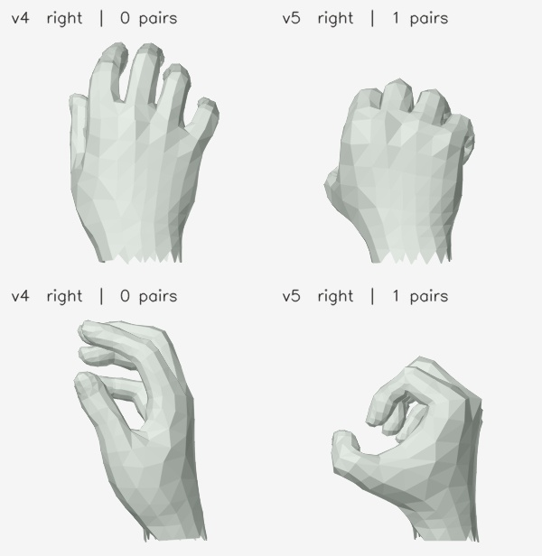
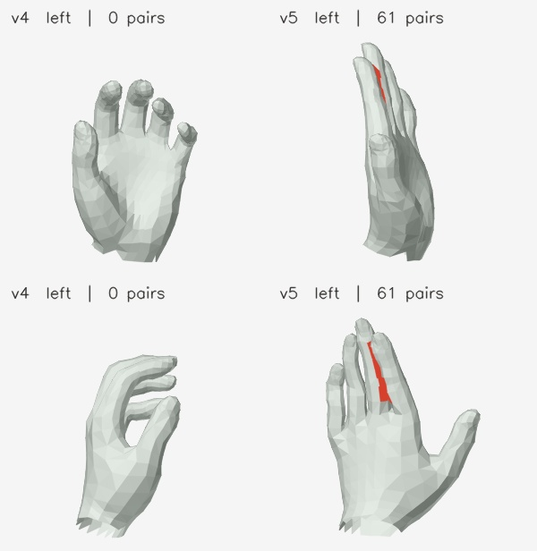
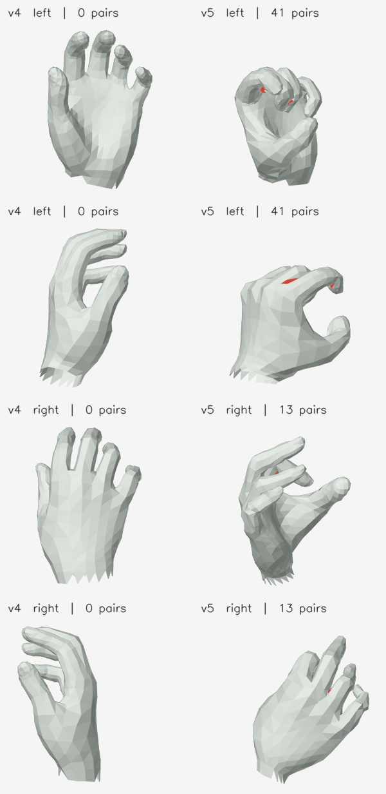
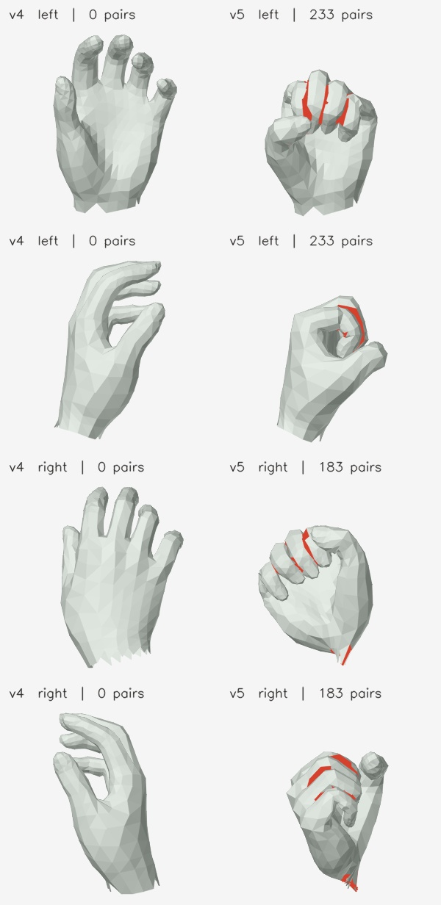

# 黄金 D v5 手内自交：同一只手的 v4、v5 对照

[全部 100 帧，逐帧标出左右手、相交面片对数与候选来源](frames.md) · [400 只手的旋转替换实验](evidence/hands.json)

原评估中仅左手 15 帧、仅右手 55 帧、双手各自发生自交 30 帧。130 只自交手都实际采用了 WiLoR：左目候选 64 只，右目候选 66 只。采用 WiLoR 共 280 只，另外 120 只保留 v4，均无自交。这里的自交均发生在同一只手的网格内部。

## 单独替换指姿或腕旋转

固定同一份 SMPL-X、身体和体型，只交换已封存参数，重建网格。每只手检查无共享顶点的三角面之间的严格内部相交。

| 参数来源 | 自交帧 | 自交手 | 相交三角面片对合计 |
|---|---:|---:|---:|
| v4 | 0 | 0 | 0 |
| 仅用 v5 腕旋转 | 10 | 10 | 67 |
| 仅用 v5 指姿 | 99 | 133 | 8080 |
| 完整 v5 | 100 | 130 | 8333 |

逐手重建与归档的 400 个计数全部一致。仅换指姿已在原有 100 帧中的 94 帧重现自交。最常见的区域组合是食指–中指（3273 对），其次是中指–无名指（1576 对）。
WiLoR 候选提供的手指旋转迁移到 SMPL-X 后固定，最终两目选解使用二维手点误差；该评分没有手内自交项。上述消融检验迁移后的指姿和腕旋转，未对原生 MANO 网格评估相交。

## 渲染

左列 v4，右列 v5。同一只手使用相同正交视角、中心和比例；每只手的两排相差 90°。红色标记参与严格相交的三角面，遮挡可能盖住部分红面。图中 pairs 是相交面片对数，不能换算成穿入深度。解剖部位按面片顶点的蒙皮权重近似归类。

### val003

人物右手共 1 对，来源 cam3。主要相交部位 中指–掌部（1）。

### val001

人物左手共 61 对，来源 cam4。主要相交部位 食指–中指（61）。

### val044

人物左手共 41 对，来源 cam4。主要相交部位 中指–中指（16）、中指–无名指（12）、中指–掌部（6）。

人物右手共 13 对，来源 cam3。主要相交部位 食指–食指（9）、中指–无名指（2）、无名指–无名指（2）。

### val184

人物左手共 233 对，来源 cam3。主要相交部位 食指–中指（100）、中指–无名指（63）、小指–无名指（54）。

人物右手共 183 对，来源 cam4。主要相交部位 食指–中指（64）、中指–无名指（57）、小指–无名指（37）。

选样包括最少相交的并列帧之一、接近中位数的单手与双手案例，以及总面片对数最多的一帧。完整统计使用全部 200 对。

## 执行与发布

基线 a887345，加本目录新增文件；工作树有无关改动。运行 bash runs/2026-11-27_v5_hand_self_review/run.sh 后运行本目录 report.py。需要受限 SMPL-X 模型与前轮验证姿态，逐帧核验 v4 和 v5 哈希。原始数据、数组与网格留在开发机。公开增量逐项检查路径、凭据、文件类型与尺寸，核对工作区、暂存、待推送提交及远端。
