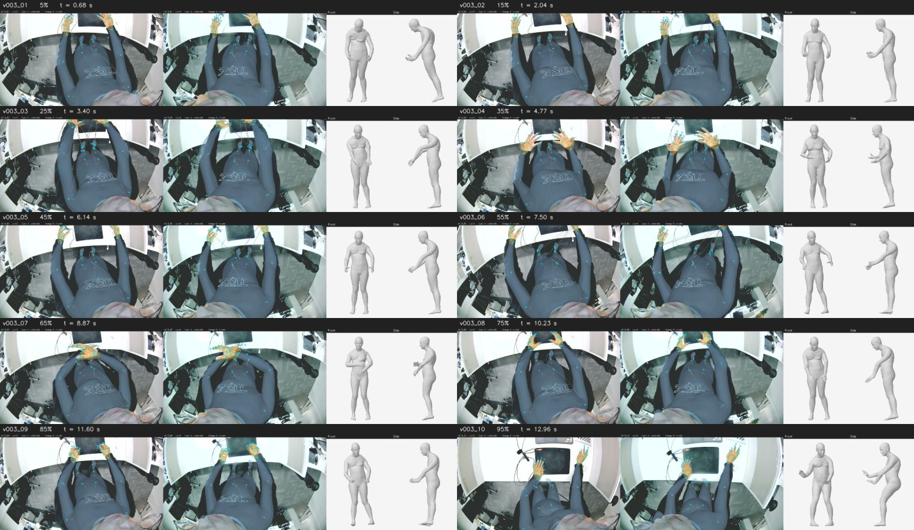

# Video 003 · 腕肘同权 Dv5 逐帧图集

按拍摄时间排列，每行两对。总览中同一对从左至右为 cam3、cam4、OBJ 正面、侧面。青叉为自动检测，橙圈为 SMPL-X 投影。按表中链接打开原尺寸图片。

| 样本 | 秒 | 双目 mesh | 自动与投影点 | 网格加点 | 全身 OBJ | 双目双手 | 手部 OBJ | 权重对照 | 指尖 RMSE（px） |
|---|---:|---|---|---|---|---|---|---|---:|
| v003_01 | 0.68 | [网格](assets/v003_01_mesh.jpg) | [点位](assets/v003_01_points.jpg) | [叠加](assets/v003_01_both.jpg) | [正侧面](assets/v003_01_obj.jpg) | [原图放大](assets/v003_01_hands.jpg) | [双角度](assets/v003_01_handobj.jpg) | [4∶1 / 1∶1](assets/v003_01_side.jpg) | 34.2 |
| v003_02 | 2.04 | [网格](assets/v003_02_mesh.jpg) | [点位](assets/v003_02_points.jpg) | [叠加](assets/v003_02_both.jpg) | [正侧面](assets/v003_02_obj.jpg) | [原图放大](assets/v003_02_hands.jpg) | [双角度](assets/v003_02_handobj.jpg) | [4∶1 / 1∶1](assets/v003_02_side.jpg) | 198.3 |
| v003_03 | 3.40 | [网格](assets/v003_03_mesh.jpg) | [点位](assets/v003_03_points.jpg) | [叠加](assets/v003_03_both.jpg) | [正侧面](assets/v003_03_obj.jpg) | [原图放大](assets/v003_03_hands.jpg) | [双角度](assets/v003_03_handobj.jpg) | [4∶1 / 1∶1](assets/v003_03_side.jpg) | 232.9 |
| v003_04 | 4.77 | [网格](assets/v003_04_mesh.jpg) | [点位](assets/v003_04_points.jpg) | [叠加](assets/v003_04_both.jpg) | [正侧面](assets/v003_04_obj.jpg) | [原图放大](assets/v003_04_hands.jpg) | [双角度](assets/v003_04_handobj.jpg) | [4∶1 / 1∶1](assets/v003_04_side.jpg) | 33.0 |
| v003_05 | 6.14 | [网格](assets/v003_05_mesh.jpg) | [点位](assets/v003_05_points.jpg) | [叠加](assets/v003_05_both.jpg) | [正侧面](assets/v003_05_obj.jpg) | [原图放大](assets/v003_05_hands.jpg) | [双角度](assets/v003_05_handobj.jpg) | [4∶1 / 1∶1](assets/v003_05_side.jpg) | 116.2 |
| v003_06 | 7.50 | [网格](assets/v003_06_mesh.jpg) | [点位](assets/v003_06_points.jpg) | [叠加](assets/v003_06_both.jpg) | [正侧面](assets/v003_06_obj.jpg) | [原图放大](assets/v003_06_hands.jpg) | [双角度](assets/v003_06_handobj.jpg) | [4∶1 / 1∶1](assets/v003_06_side.jpg) | 229.7 |
| v003_07 | 8.87 | [网格](assets/v003_07_mesh.jpg) | [点位](assets/v003_07_points.jpg) | [叠加](assets/v003_07_both.jpg) | [正侧面](assets/v003_07_obj.jpg) | [原图放大](assets/v003_07_hands.jpg) | [双角度](assets/v003_07_handobj.jpg) | [4∶1 / 1∶1](assets/v003_07_side.jpg) | 39.0 |
| v003_08 | 10.23 | [网格](assets/v003_08_mesh.jpg) | [点位](assets/v003_08_points.jpg) | [叠加](assets/v003_08_both.jpg) | [正侧面](assets/v003_08_obj.jpg) | [原图放大](assets/v003_08_hands.jpg) | [双角度](assets/v003_08_handobj.jpg) | [4∶1 / 1∶1](assets/v003_08_side.jpg) | 13.0 |
| v003_09 | 11.60 | [网格](assets/v003_09_mesh.jpg) | [点位](assets/v003_09_points.jpg) | [叠加](assets/v003_09_both.jpg) | [正侧面](assets/v003_09_obj.jpg) | [原图放大](assets/v003_09_hands.jpg) | [双角度](assets/v003_09_handobj.jpg) | [4∶1 / 1∶1](assets/v003_09_side.jpg) | 21.6 |
| v003_10 | 12.96 | [网格](assets/v003_10_mesh.jpg) | [点位](assets/v003_10_points.jpg) | [叠加](assets/v003_10_both.jpg) | [正侧面](assets/v003_10_obj.jpg) | [原图放大](assets/v003_10_hands.jpg) | [双角度](assets/v003_10_handobj.jpg) | [4∶1 / 1∶1](assets/v003_10_side.jpg) | 25.1 |

## 同帧误差对比

原图像素 RMSE 按两眼、两手所有有效观测合并。自动检测和遮挡会影响这些指标。

| 腕∶肘权重 | 肘点 RMSE | 腕点 RMSE | 留出五指尖 RMSE |
|---|---:|---:|---:|
| 4∶1 | 9.96 | 5.41 | 121.00 |
| 1∶1 | 9.10 | 6.45 | 121.17 |

候选来源发生变化的手共 0 只。逐帧细节见数值证据。

双目帧、身体 v4 起点、紫线平移、检测点及手形候选沿用原实验。肩肘校正将腕点权重调为与肘点相同，再独立运行逐手候选选择和腕旋转拟合。原 4∶1 结果逐值复现，双目渲染和侧视都使用实际导出的 OBJ。该实验未改变默认配置。[原 4∶1 图集](../2026-11-27_video34_uniform_v5/video003.md) · [逐帧证据](evidence/summary.json)

执行基线 3bfd86c06a8b339ca71d8c0aac085747df796fb9，工作树含本轮和既有无关改动。运行仓库内 run.sh 对索引 0 至 9，随后运行 package.py。OBJ 回读及 ZIP 哈希已核对，原始网格位于开发机输出目录。公开前检查文件大小、凭据、机器路径和 JPEG 元数据。
