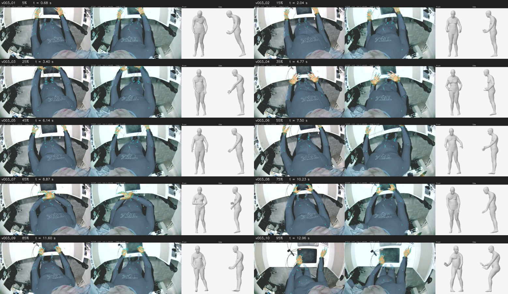

# Video 003 · v4 身体直接进入 Dv5 逐帧图集

按拍摄时间排列，每行两对。总览中同一对从左至右为 cam3、cam4、OBJ 正面、侧面。青叉为自动检测，橙圈为 SMPL-X 投影。按表中链接打开原尺寸图片。

| 样本 | 秒 | 双目 mesh | 自动与投影点 | 网格加点 | 全身 OBJ | 双目双手 | 手部 OBJ | 指尖 RMSE（px） | 手部状态 |
|---|---:|---|---|---|---|---|---|---:|---|
| v003_01 | 0.68 | [网格](assets/v003_01_mesh.jpg) | [点位](assets/v003_01_points.jpg) | [叠加](assets/v003_01_both.jpg) | [正侧面](assets/v003_01_obj.jpg) | [原图放大](assets/v003_01_hands.jpg) | [双角度](assets/v003_01_handobj.jpg) | 28.9 | 双手选解 |
| v003_02 | 2.04 | [网格](assets/v003_02_mesh.jpg) | [点位](assets/v003_02_points.jpg) | [叠加](assets/v003_02_both.jpg) | [正侧面](assets/v003_02_obj.jpg) | [原图放大](assets/v003_02_hands.jpg) | [双角度](assets/v003_02_handobj.jpg) | 198.7 | 双手选解 |
| v003_03 | 3.40 | [网格](assets/v003_03_mesh.jpg) | [点位](assets/v003_03_points.jpg) | [叠加](assets/v003_03_both.jpg) | [正侧面](assets/v003_03_obj.jpg) | [原图放大](assets/v003_03_hands.jpg) | [双角度](assets/v003_03_handobj.jpg) | 240.1 | 右手回退 |
| v003_04 | 4.77 | [网格](assets/v003_04_mesh.jpg) | [点位](assets/v003_04_points.jpg) | [叠加](assets/v003_04_both.jpg) | [正侧面](assets/v003_04_obj.jpg) | [原图放大](assets/v003_04_hands.jpg) | [双角度](assets/v003_04_handobj.jpg) | 33.5 | 双手选解 |
| v003_05 | 6.14 | [网格](assets/v003_05_mesh.jpg) | [点位](assets/v003_05_points.jpg) | [叠加](assets/v003_05_both.jpg) | [正侧面](assets/v003_05_obj.jpg) | [原图放大](assets/v003_05_hands.jpg) | [双角度](assets/v003_05_handobj.jpg) | 116.4 | 双手选解 |
| v003_06 | 7.50 | [网格](assets/v003_06_mesh.jpg) | [点位](assets/v003_06_points.jpg) | [叠加](assets/v003_06_both.jpg) | [正侧面](assets/v003_06_obj.jpg) | [原图放大](assets/v003_06_hands.jpg) | [双角度](assets/v003_06_handobj.jpg) | 229.8 | 双手选解 |
| v003_07 | 8.87 | [网格](assets/v003_07_mesh.jpg) | [点位](assets/v003_07_points.jpg) | [叠加](assets/v003_07_both.jpg) | [正侧面](assets/v003_07_obj.jpg) | [原图放大](assets/v003_07_hands.jpg) | [双角度](assets/v003_07_handobj.jpg) | 38.1 | 双手选解 |
| v003_08 | 10.23 | [网格](assets/v003_08_mesh.jpg) | [点位](assets/v003_08_points.jpg) | [叠加](assets/v003_08_both.jpg) | [正侧面](assets/v003_08_obj.jpg) | [原图放大](assets/v003_08_hands.jpg) | [双角度](assets/v003_08_handobj.jpg) | 13.0 | 双手选解 |
| v003_09 | 11.60 | [网格](assets/v003_09_mesh.jpg) | [点位](assets/v003_09_points.jpg) | [叠加](assets/v003_09_both.jpg) | [正侧面](assets/v003_09_obj.jpg) | [原图放大](assets/v003_09_hands.jpg) | [双角度](assets/v003_09_handobj.jpg) | 21.0 | 双手选解 |
| v003_10 | 12.96 | [网格](assets/v003_10_mesh.jpg) | [点位](assets/v003_10_points.jpg) | [叠加](assets/v003_10_both.jpg) | [正侧面](assets/v003_10_obj.jpg) | [原图放大](assets/v003_10_hands.jpg) | [双角度](assets/v003_10_handobj.jpg) | 18.2 | 双手选解 |

## 同帧结果

身体自动点 RMSE 为 **10.15 px**（240 个观测），画内五指尖 RMSE 为 **122.42 px**（166 个观测）。误差使用两眼自动检测，遮挡和错误检测会影响数值。[逐帧详情](evidence/summary.json)

每对使用同一批同步图像和哈希核验的 v4 原身体选姿，直接执行冻结 v5 的透视 WiLoR 逐手候选选择与双目腕旋转。固定肩、肘和腕中心，身体主关节最大位移低于 0.001 mm。十份网格重新导出并回读验证。此处理沿用 v4 原有头部目标；003、004 紫线平移及其肩肘校正未应用。[原视频实验图集](../2026-11-27_video34_uniform_v5/video003.md) · [同权肩肘校正图集](../2026-11-27_video003_equal_v5/report.md)

基线 90bf2404173e319f6a633d31c89af493c5671235。工作树含本轮新增文件和既有无关改动。运行本目录 run.sh，索引依次为 0 至 9，再运行 package.py。输入、网格、候选及图像指纹见证据；OBJ 压缩包保存在开发机输出目录。推送前核对工作区、暂存区、增量提交及远端，检查文件大小、JPEG 元数据、凭据及机器路径。
