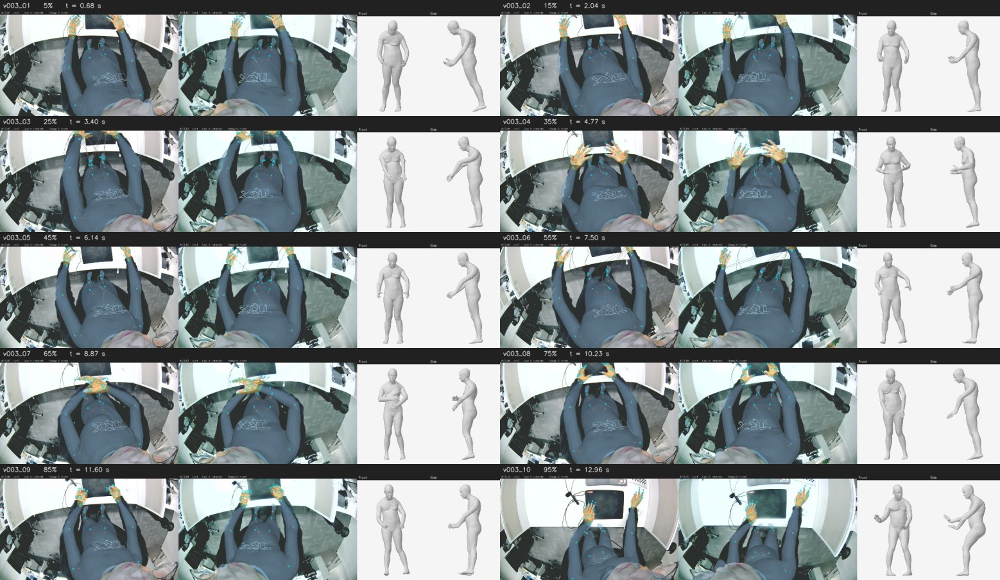
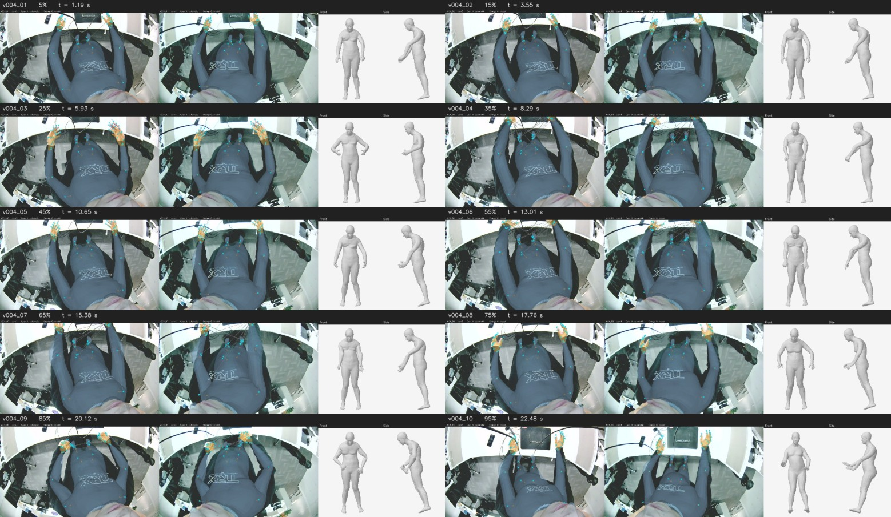

# Video 003、004 · 黄金 D v5 每段十对

每段取左右相机共同录制时长的 5%、15%、…、95% 共十个时刻，以左目最接近的帧配右目时间最近的帧。二十对独立运行；每张全身投影、正侧视和手部图都使用本对最终 cam3 米制 OBJ。

**[Video 003 十对原尺寸图集](video003.md) · [Video 004 十对原尺寸图集](video004.md)**

每个样本均可单独打开双目纯 mesh、双目点位、mesh 加点、全身 OBJ 正侧面、双手原图及叠加放大、手部 OBJ 两个观察角度。双目图左为 cam3、右为 cam4。青叉为 Sapiens2 RW20000 自动点，橙圈为同一 SMPL-X 网格对应的模型关节投影。点位图展示有效身体点和画内的手部点，含留出指尖。

| 视频 | 对数 | 身体自动点 RMSE（px） | 身体观测数 | 留出五指尖 RMSE（px） | 指尖观测数 | 选到 WiLoR 候选的手 |
|---|---:|---:|---:|---:|---:|---:|
| 003 | 10 | 27.42 | 240 | 121.00 | 166 | 19/20 |
| 004 | 10 | 29.88 | 240 | 146.42 | 173 | 20/20 |

按段合并所有相应的有效二维观测，平均平方欧氏距离后开根，单位为原鱼眼图像素。自动点来自模型检测；真实三维关节与手指缺少独立标注。图集中保留回退手的画内指尖。双手放大图按可见网格取景，落到远处衣服或背景的自动点仍在全幅点位图中显示，也照常计入画内指尖误差。

最终手部回退：v003_03 右手（no candidate）。

逐帧差异很大。Video 004 第 5 对的双目指尖 RMSE 为 16.2 px，第 7 对为 350.9 px；第 7 对的全幅图中可见一些自动手点落到躯干。这个误差同时包含自动检测与网格投影的差异。[第 5 对手部放大](assets/v004_05_hands.jpg) · [第 7 对全幅点位](assets/v004_07_points.jpg)

## 方法与复核

执行起点 bcec42c2914811bf08b737316a17cfc483d0d716。工作树存在本轮新增文件和既有无关改动。沿用 003、004 的真实双目鱼眼标定，每张重新推理 RW20000 身体与手点、Sapiens2 语义分割及透视 WiLoR 观测。按 v3 的 20,000 步和肢体候选生成身体起点，再运行 v4 固定踝、前脚掌和手指的全轮廓细化与最终候选选择。20 个初拟合均有可行解，其中 12 个通过严格末段稳定性检查。[执行与收敛诊断](evidence/execution.json)

依照该机位的 003/004 参考流程，使用既有紫线平移，逐帧拟合肩肘以校正双目腕的位置。掌面初始化需要两手指根均画内且三角化为正深度；不满足时保留本帧 v4 身体作为平移和校正的起点。双目腕目标和肘点按各眼有效性使用。这是身体起点的回退，与最终按手选择 WiLoR 候选分开统计。最后在冻结的黄金 D v5 手部入口中，将两眼透视 WiLoR 候选分别映射到 SMPL-X，固定各候选指姿，依双目非指尖误差求腕旋转并逐手选解。此处使用相同视频既有的平移标定，未逐帧重标定佩戴几何。[方法清单](../../configs/golden_d.current.json) · [透视候选](evidence/predictions.json) · [分段计数及逐帧数值](evidence/summary.json)

最大左右目时差 1.5863 ms。已核对采集时间戳、解码帧序号与容器 PTS 的相对间隔。20 份 OBJ 全部回读检查顶点和拓扑，并核对 ZIP 成员哈希。开发机仓库相对路径为 `outputs/video34_uniform_v5_20261127/twenty_Dv5_cam3_m_OBJ.zip`。[抽样与索引](evidence/frames.json) · [视频与时间戳核验](evidence/timing.json)

在具备原视频及既有模型环境的开发机从仓库根目录运行本目录 all.sh。公开数字保留原值，命令路径用仓库相对路径或 <RUN> 表示。推送前核对工作区、暂存与待推增量、远端提交，只发布代码、文档、脱敏数值和派生渲染；逐项检查 JPEG 元数据、单文件大小、机器路径和凭据。原图、视频、模型、数组和完整 OBJ 留在开发机。
