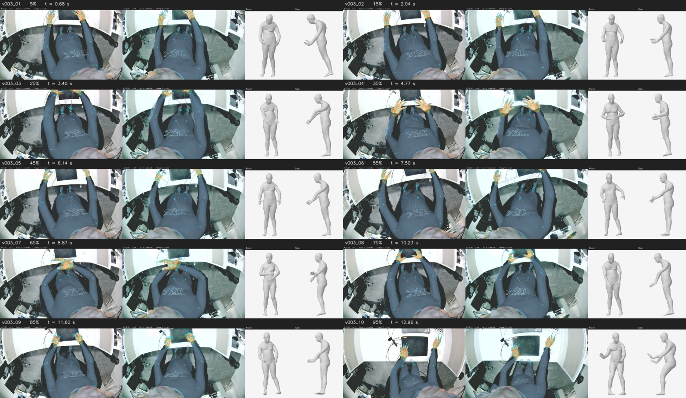

# Video 003 · Dv5 逐帧图集

按拍摄时间排列，每行两对。总览中同一对从左至右为 cam3、cam4、OBJ 正面、侧面。青叉为自动检测，橙圈为 SMPL-X 投影。按表中链接打开原尺寸图片。

| 样本 | 秒 | 双目 mesh | 自动与投影点 | 网格加点 | 全身 OBJ | 双目双手 | 手部 OBJ | 指尖 RMSE（px） | 手部状态 |
|---|---:|---|---|---|---|---|---|---:|---|
| v003_01 | 0.68 | [网格](assets/v003_01_mesh.jpg) | [点位](assets/v003_01_points.jpg) | [叠加](assets/v003_01_both.jpg) | [正侧面](assets/v003_01_obj.jpg) | [原图放大](assets/v003_01_hands.jpg) | [双角度](assets/v003_01_handobj.jpg) | 31.8 | 双手选解 |
| v003_02 | 2.04 | [网格](assets/v003_02_mesh.jpg) | [点位](assets/v003_02_points.jpg) | [叠加](assets/v003_02_both.jpg) | [正侧面](assets/v003_02_obj.jpg) | [原图放大](assets/v003_02_hands.jpg) | [双角度](assets/v003_02_handobj.jpg) | 199.1 | 双手选解 |
| v003_03 | 3.40 | [网格](assets/v003_03_mesh.jpg) | [点位](assets/v003_03_points.jpg) | [叠加](assets/v003_03_both.jpg) | [正侧面](assets/v003_03_obj.jpg) | [原图放大](assets/v003_03_hands.jpg) | [双角度](assets/v003_03_handobj.jpg) | 233.8 | 右手回退 |
| v003_04 | 4.77 | [网格](assets/v003_04_mesh.jpg) | [点位](assets/v003_04_points.jpg) | [叠加](assets/v003_04_both.jpg) | [正侧面](assets/v003_04_obj.jpg) | [原图放大](assets/v003_04_hands.jpg) | [双角度](assets/v003_04_handobj.jpg) | 17.7 | 双手选解 |
| v003_05 | 6.14 | [网格](assets/v003_05_mesh.jpg) | [点位](assets/v003_05_points.jpg) | [叠加](assets/v003_05_both.jpg) | [正侧面](assets/v003_05_obj.jpg) | [原图放大](assets/v003_05_hands.jpg) | [双角度](assets/v003_05_handobj.jpg) | 116.2 | 双手选解 |
| v003_06 | 7.50 | [网格](assets/v003_06_mesh.jpg) | [点位](assets/v003_06_points.jpg) | [叠加](assets/v003_06_both.jpg) | [正侧面](assets/v003_06_obj.jpg) | [原图放大](assets/v003_06_hands.jpg) | [双角度](assets/v003_06_handobj.jpg) | 229.7 | 双手选解 |
| v003_07 | 8.87 | [网格](assets/v003_07_mesh.jpg) | [点位](assets/v003_07_points.jpg) | [叠加](assets/v003_07_both.jpg) | [正侧面](assets/v003_07_obj.jpg) | [原图放大](assets/v003_07_hands.jpg) | [双角度](assets/v003_07_handobj.jpg) | 38.8 | 双手选解 |
| v003_08 | 10.23 | [网格](assets/v003_08_mesh.jpg) | [点位](assets/v003_08_points.jpg) | [叠加](assets/v003_08_both.jpg) | [正侧面](assets/v003_08_obj.jpg) | [原图放大](assets/v003_08_hands.jpg) | [双角度](assets/v003_08_handobj.jpg) | 13.0 | 双手选解 |
| v003_09 | 11.60 | [网格](assets/v003_09_mesh.jpg) | [点位](assets/v003_09_points.jpg) | [叠加](assets/v003_09_both.jpg) | [正侧面](assets/v003_09_obj.jpg) | [原图放大](assets/v003_09_hands.jpg) | [双角度](assets/v003_09_handobj.jpg) | 21.7 | 双手选解 |
| v003_10 | 12.96 | [网格](assets/v003_10_mesh.jpg) | [点位](assets/v003_10_points.jpg) | [叠加](assets/v003_10_both.jpg) | [正侧面](assets/v003_10_obj.jpg) | [原图放大](assets/v003_10_hands.jpg) | [双角度](assets/v003_10_handobj.jpg) | 24.9 | 双手选解 |
