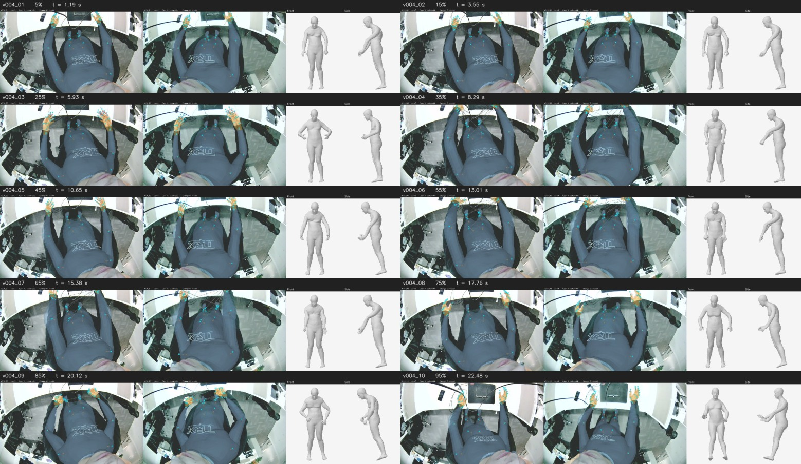

# Video 004 · Dv5 逐帧图集

按拍摄时间排列，每行两对。总览中同一对从左至右为 cam3、cam4、OBJ 正面、侧面。青叉为自动检测，橙圈为 SMPL-X 投影。按表中链接打开原尺寸图片。

| 样本 | 秒 | 双目 mesh | 自动与投影点 | 网格加点 | 全身 OBJ | 双目双手 | 手部 OBJ | 指尖 RMSE（px） | 手部状态 |
|---|---:|---|---|---|---|---|---|---:|---|
| v004_01 | 1.19 | [网格](assets/v004_01_mesh.jpg) | [点位](assets/v004_01_points.jpg) | [叠加](assets/v004_01_both.jpg) | [正侧面](assets/v004_01_obj.jpg) | [原图放大](assets/v004_01_hands.jpg) | [双角度](assets/v004_01_handobj.jpg) | 20.6 | 双手选解 |
| v004_02 | 3.55 | [网格](assets/v004_02_mesh.jpg) | [点位](assets/v004_02_points.jpg) | [叠加](assets/v004_02_both.jpg) | [正侧面](assets/v004_02_obj.jpg) | [原图放大](assets/v004_02_hands.jpg) | [双角度](assets/v004_02_handobj.jpg) | 63.9 | 双手选解 |
| v004_03 | 5.93 | [网格](assets/v004_03_mesh.jpg) | [点位](assets/v004_03_points.jpg) | [叠加](assets/v004_03_both.jpg) | [正侧面](assets/v004_03_obj.jpg) | [原图放大](assets/v004_03_hands.jpg) | [双角度](assets/v004_03_handobj.jpg) | 37.3 | 双手选解 |
| v004_04 | 8.29 | [网格](assets/v004_04_mesh.jpg) | [点位](assets/v004_04_points.jpg) | [叠加](assets/v004_04_both.jpg) | [正侧面](assets/v004_04_obj.jpg) | [原图放大](assets/v004_04_hands.jpg) | [双角度](assets/v004_04_handobj.jpg) | 234.0 | 双手选解 |
| v004_05 | 10.65 | [网格](assets/v004_05_mesh.jpg) | [点位](assets/v004_05_points.jpg) | [叠加](assets/v004_05_both.jpg) | [正侧面](assets/v004_05_obj.jpg) | [原图放大](assets/v004_05_hands.jpg) | [双角度](assets/v004_05_handobj.jpg) | 16.2 | 双手选解 |
| v004_06 | 13.01 | [网格](assets/v004_06_mesh.jpg) | [点位](assets/v004_06_points.jpg) | [叠加](assets/v004_06_both.jpg) | [正侧面](assets/v004_06_obj.jpg) | [原图放大](assets/v004_06_hands.jpg) | [双角度](assets/v004_06_handobj.jpg) | 208.8 | 双手选解 |
| v004_07 | 15.38 | [网格](assets/v004_07_mesh.jpg) | [点位](assets/v004_07_points.jpg) | [叠加](assets/v004_07_both.jpg) | [正侧面](assets/v004_07_obj.jpg) | [原图放大](assets/v004_07_hands.jpg) | [双角度](assets/v004_07_handobj.jpg) | 350.9 | 双手选解 |
| v004_08 | 17.76 | [网格](assets/v004_08_mesh.jpg) | [点位](assets/v004_08_points.jpg) | [叠加](assets/v004_08_both.jpg) | [正侧面](assets/v004_08_obj.jpg) | [原图放大](assets/v004_08_hands.jpg) | [双角度](assets/v004_08_handobj.jpg) | 19.6 | 双手选解 |
| v004_09 | 20.12 | [网格](assets/v004_09_mesh.jpg) | [点位](assets/v004_09_points.jpg) | [叠加](assets/v004_09_both.jpg) | [正侧面](assets/v004_09_obj.jpg) | [原图放大](assets/v004_09_hands.jpg) | [双角度](assets/v004_09_handobj.jpg) | 97.1 | 双手选解 |
| v004_10 | 22.48 | [网格](assets/v004_10_mesh.jpg) | [点位](assets/v004_10_points.jpg) | [叠加](assets/v004_10_both.jpg) | [正侧面](assets/v004_10_obj.jpg) | [原图放大](assets/v004_10_hands.jpg) | [双角度](assets/v004_10_handobj.jpg) | 18.2 | 双手选解 |
