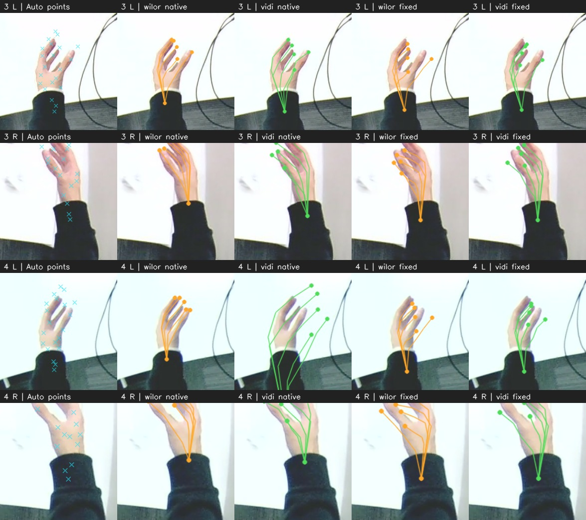

# ViDiHand2 与 WiLoR 在 003、004 上的双目对照

**用同一个 B 腕驱动全身 SMPL-X 时，两种模型的指姿很接近。** 33 个画内留出指尖对自动点的二维 RMSE 为 WiLoR 18.59 px、ViDiHand2 18.07 px。直接使用各模型自己的手部定位时，WiLoR 为 15.41 px，ViDiHand2 为 21.85 px。ViDiHand2 在视频窗口内给出手部结果的帧数更多。003、004 只有两个中心时刻有本轮使用的自动点参照，无法据此判定三维精度或遮挡期间的准确率。[逐手分数、原生投影和留出误差](evidence/metrics.json)

| 同一批指尖，单位 px，越低越好 | WiLoR | ViDiHand2 |
|---|---:|---:|
| 原生关节投影，各用自己的手部定位 | 15.41 | 21.85 |
| 原生 MANO 关节投影 | 15.41 | 21.86 |
| 共享 B 腕与身体，仅替换指姿，双目逐手选来源 | 18.59 | 18.07 |

四张中心图里，两种模型均给左右手输出，所以三行指标均覆盖相同的 33 个画内指尖。原 B 连同手指一起拟合为 13.32 px。此前腕框引导的 WiLoR 在 B 腕上为 27.77 px，本轮 WiLoR 使用透视图和自身检测框，输入几何和取框方式同时变化。[原 B 与历史 WiLoR](../2026-11-27_stereo_hand_selection/report.md)

## 看手部实际位置和形状

| 片段 | 双手放大 | 双目原尺寸投影 | 手部 OBJ 两个角度 | 全身 OBJ 正侧面 |
|---|---|---|---|---|
| 003 | [原图与两种模型](assets/clip003_hands.jpg) | [左目](assets/clip003_cam3.jpg) / [右目](assets/clip003_cam4.jpg) | [B、WiLoR、ViDiHand2](assets/clip003_local_OBJ.jpg) | [WiLoR](assets/clip003_wilor_body.jpg) / [ViDiHand2](assets/clip003_vidi_body.jpg) |
| 004 | [原图与两种模型](assets/clip004_hands.jpg) | [左目](assets/clip004_cam3.jpg) / [右目](assets/clip004_cam4.jpg) | [B、WiLoR、ViDiHand2](assets/clip004_local_OBJ.jpg) | [WiLoR](assets/clip004_wilor_body.jpg) / [ViDiHand2](assets/clip004_vidi_body.jpg) |

每行依次为自动点、WiLoR 原生、ViDiHand2 原生、WiLoR 固定 B 腕、ViDiHand2 固定 B 腕。行首 3/4 是相机，L/R 是人物的手。003 的第三行值得看：在 cam4 中，ViDiHand2 的左手腕相对自动腕点偏了 99.24 px，WiLoR 偏 19.03 px。ViDiHand2 仍将这只手标为有效。固定 B 腕并按双目评分取 cam3 指姿后，两眼共享的左手投影更贴近手部区域。004 的 OBJ 里，两种方法都保留了左手拇指与四指围成的开口。[004 手部 OBJ](assets/clip004_local_OBJ.jpg)

| 片段与人物手 | 画内指尖数 | WiLoR 原生 | ViDiHand2 原生 | WiLoR 固定 B 腕（来源） | ViDiHand2 固定 B 腕（来源） |
|---|---:|---:|---:|---:|---:|
| 003 左 | 10 | 17.62 | 25.08 | 23.51（cam3） | 23.22（cam3） |
| 003 右 | 3 | 22.20 | 15.14 | 22.00（cam3） | 21.63（cam4） |
| 004 左 | 10 | 12.15 | 23.20 | 16.05（cam3） | 15.62（cam4） |
| 004 右 | 10 | 13.35 | 18.41 | 13.61（cam3） | 12.41（cam4） |

## 视频窗口内的检测覆盖

四段单眼视频各 81 帧，每帧分别统计人物左手和右手，共 648 次观察。ViDiHand2 有效手为 648/648。WiLoR 在置信度 0.20 下有对应侧框的为 598/648；003 右目右手为 61/81。同一类别出现多个 WiLoR 框的有 191 次，中心帧按同侧最高置信度取框。ViDiHand2 按官方阈值与三维有限性判断有效手；有输出只表明模型给出了该侧预测。视频没有逐帧可见性真值，不能将上述计数换算为检测召回率，也不能由此证明遮挡时手形正确。[WiLoR 逐帧框数](evidence/temporal.json) · [ViDiHand2 逐帧有效标记](evidence/vidi.json) · [WiLoR 中心帧检测](evidence/wilor.json)

## 输入、选择规则和核验

两模型使用相同标定的 640 × 480 虚拟透视画布。每眼的 81 帧以原始同步中心帧为中点；各眼实际采样帧率、源帧号以及原图像素一致性已归档。WiLoR 对同一中心图单帧推理，自行检测；ViDiHand2 使用整段视频和 K，保留官方默认模式和官方关节至 MANO 的拟合。原生误差统一回到原尺寸鱼眼像素计算。WiLoR 先取自身投影的图上像素，再用虚拟 K 求射线；ViDiHand2 使用虚拟相机内对应三维关节的射线。两者共享原鱼眼投影函数。[四段视频输入](../2026-11-27_vidihand2_wrist/evidence/video.json) · [模型推理](predict.py)

固定腕条件取两模型 MANO 的 15 个局部旋转。按人物左右手镜像、源手与目标手中立掌形及 SMPL-X 均值进行映射，两侧腕旋转均直接继承 B。每手的两个候选各投到两眼，用筛过的最多 15 个非指尖关节和原有鲁棒分数选择一套，两眼等权；五个指尖一直留出。左右手合并为一份 SMPL-X 重新前向，核对两种方法在两帧的身体和腕中心位移均为 0 mm，合成后投影复现获选候选。全身图来自选中网格的 OBJ 回读。[对照脚本](compare.py)

## 执行与发布

实际运行基线为 228d4d4717e4bf61c5029121fab19d80f3f55104，工作树有既存无关更改。按用户确认，仅用一张 A100，复用已安装的 CUDA PyTorch 2.7.0 环境完成。官方代码和两份 ViDiHand2 权重按照固定版本获取；大文件断点恢复时重新补取未写满的片段，最终完整 SHA-256 与官方清单相同。MANO 文件的序列化哈希有差异，实际载入的八项模型张量、拓扑和骨架参数最大绝对差均为零。推理使用本地已有 MANO。研究代码依赖外部模型、私有原视频和此前归档输入。[下载校验](evidence/download.json) · [MANO 对照](evidence/mano.json) · [执行与环境记录](evidence/execution.json)

从仓库根目录依次运行本目录 fetch.py，再用 run.py 的 wilor、temporal、vidi、compare 四个参数分别执行。Git 只发布此 run 的脚本、派生图和精简证据；未包含权重、视频、原始图片、数组、完整本地日志或机器路径。推送前核查工作区、暂存与待推增量、远端、单文件大小、凭据和敏感路径，并核验所有 JPEG 的内容摘要和尺寸。[发布自检](evidence/prepush.json)
