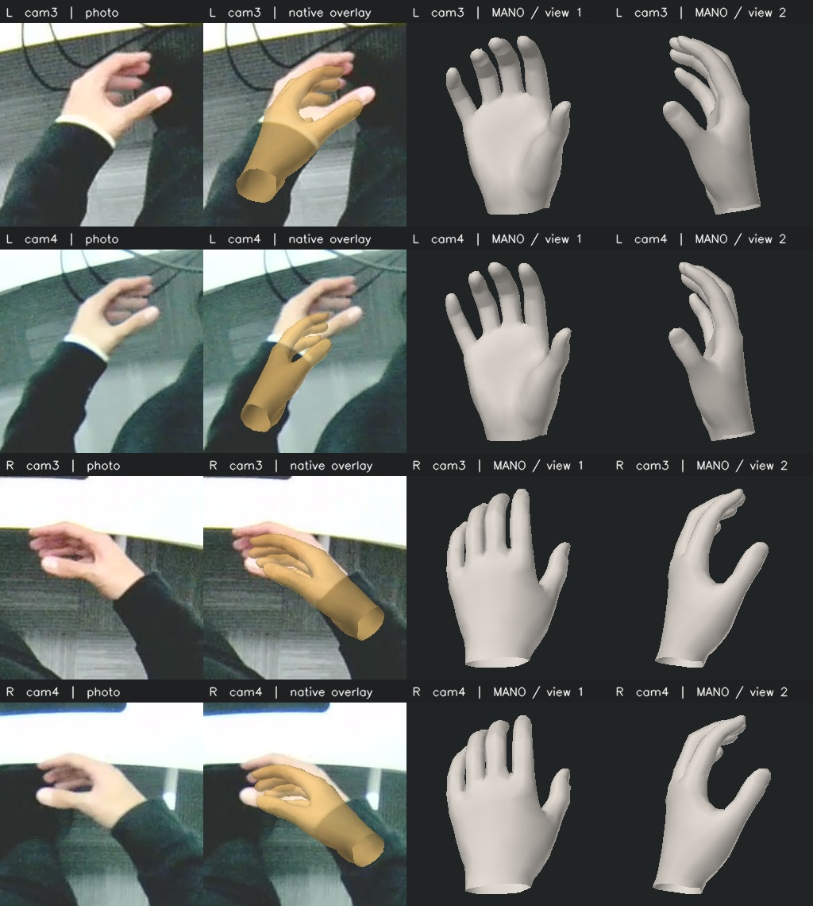
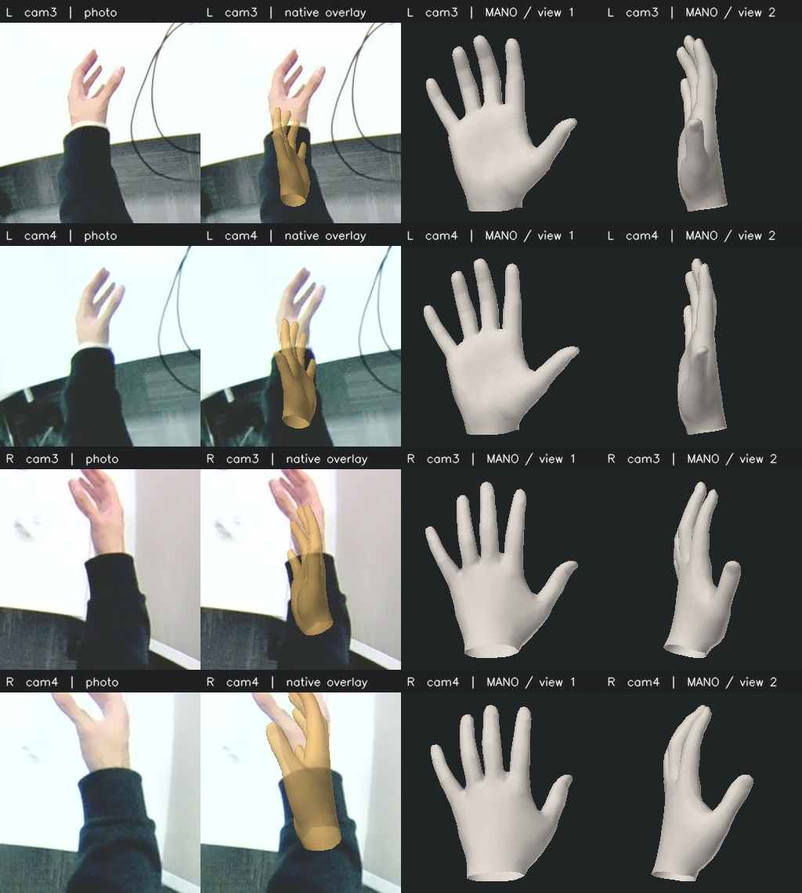

# 003、004 原生 WiLoR 的手形与原图位置

每行对应人物的一只手在一个相机中的独立预测。由左到右依次是干净原图、WiLoR 按自身相机参数投回同一张图的实体网格、同一网格的两个掌部局部视角。后两列按手部坐标定向、单独缩放，适合比较弯曲和张开程度。L、R 指人物左、右手，cam3、cam4 指左、右相机。腕端开口为独立 MANO 手网格边界。

## 004

004 左手的四指自然弯曲，与拇指围出半握开口。看第二行的 cam4，网格整体偏向袖口，伸出的拇指和照片里的拇指有明显间距。只看最后两列容易忽略这个位置差。[同帧全身 SMPL-X 的 A/B 手形](../2026-11-27_smplx_stereo_fingers/assets/clip004_mesh_hands.jpg)

## 003

两眼对左手的独立预测都较为伸展。第二列可见，掌面有较大一部分投在袖子上；右手的一些指尖接近或超出原画面。照片窗口与叠加列共用裁切和缩放，裁切没有移动网格相对图像的位置。

## 旧项目的手是怎么接的？

用户此前使用的 EgoSmplx 工程有一条明确的网格融合路线。取得 WiLoR 的 MANO 手，按 SMPL-X 身体腕与鱼眼标定放置，匹配身体和手的腕环，在腕界附近调整网格并连接，输出整个人的显式网格。该实现保留 16 个共享腕界点，局部接缝位移集中在腕部，远端手指保留预测的形状。原始标准身体参数和最终融合网格分别保存。[旧项目接缝实现](https://github.com/cdh290718-oss/EgoSmplx/blob/269ec28d10b779045136b907d1fe2f9ee2acf0f7/egosmplx_pipeline/reference/contour_seam.py#L46) · [设计说明](../../docs/DESIGN_zh.md)

上游论文 EgoSMPLX 的原始网络另有手部回归分支，将预测的左右手姿参数交给 SMPL-X 层生成全身网格。最近的 A/B 实验则使用双目图像点与分割轮廓更新全身 SMPL-X 的腕和手指旋转。三者的手形来源和最终输出有区别。[上游手姿回归](https://github.com/naso06/EgoSMPLX/blob/61f624ffbd4c18cd8b4a193a00fc9dca81c69a19/main/SMPLer_X.py#L638) · [上游网格生成](https://github.com/naso06/EgoSMPLX/blob/61f624ffbd4c18cd8b4a193a00fc9dca81c69a19/main/SMPLer_X.py#L446) · [最近的全身手部拟合](../2026-11-27_smplx_stereo_fingers/report.md)

## 核验与复现

执行基线为 248cbfc9d06701396f00f08963aa300d888857e5，工作树有既存无关修改。沿用归档四张真实相机图、Sapiens2 腕引导框、WiLoR 检查点、左右手镜像处理与单眼完整图投影。每只手保留该次网络给出的三维网格、相机平移与指姿，逐顶点和逐关节复核原生投影；单独展示时才改变查看角度。局部窗口由输入手点和网格包围范围生成，异常检测点在决定窗口时剔除。可用 bash 运行本目录的 run.sh。[图像、投影回放与网格证据](evidence/results.json)

初次尝试用 CPU 从归档手参数反求相机平移，003 cam3 左手最大顶点投影差 0.060 px，超过预设的 0.05 px 校验限；最终重新运行原始 GPU 前向，直接取网络输出与既有归档比对。[执行记录](evidence/execution.json)

本次增量发布派生手部裁图、实体网格渲染图、脚本和脱敏证据。推送前检查工作区、暂存、增量提交与远端，核对文件大小、图像格式与元数据。单文件小于 50 MB，无权重、数组、视频、原始帧文件、凭据或机器绝对路径。[发布前检查](evidence/prepush.json)
