# 固定骨架的双目轮廓体表拟合 · 24 对

沿用指定图库的 24 帧固定躯干姿态，对每帧固定整套骨架和位姿，仅调整标准 SMPL-X 十维形变基带来的蒙皮表面位移。每帧左右目共同拟合，单人不同帧各自独立估计。以下渲染读取本轮生成的 OBJ，沿用原图库正侧视方向。点图可放大。

| 指标 | 基线 | 固定骨架、轮廓体表 |
|---|---:|---:|
| 12 点 PA-MPJPE（mm） | 42.10 | 42.10 |
| 12 点非 PA MPJPE（mm） | 58.96 | 58.96 |
| 双目轮廓距离（px） | 17.17 | 15.00 |

PA 为每帧 12 点相似对齐后的平均关节误差，非 PA 在左相机坐标直接计算。轮廓距离为模型与 Sapiens2 分割边界的截断双向距离，参与拟合；它衡量对预测分割的贴合。关节沿用基线，PA 和非 PA 保持一致，不能由这些指标判断表面形状是否准确。逐帧重算与原固定躯干评分最大差小于 0.001 mm。[数值核查](evidence/verification.json) · [逐帧数据](evidence/results.json)

| 人物 / 样本 | 基线 OBJ 正面 | 基线 OBJ 侧面 | 调整后 OBJ 正面 | 调整后 OBJ 侧面 | PA mm | 非 PA mm |
|---|---|---|---|---|---:|---:|
| S1 / pair001 | [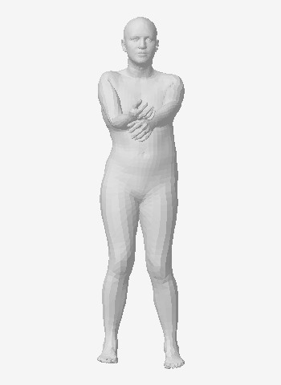](../2026-11-23_fixed_floor24/assets/pair001/front.jpg) |  | [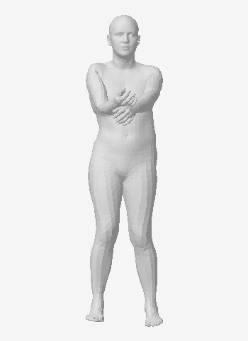](assets/pair001/front.jpg) | [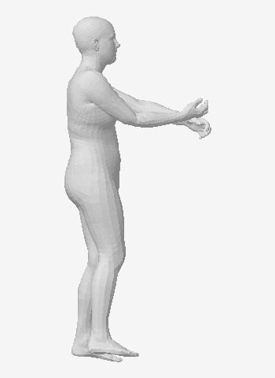](assets/pair001/side.jpg) | 38.94 | 48.10 |
| S1 / pair022 | [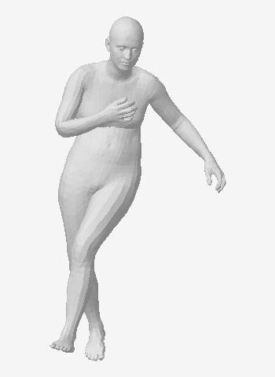](../2026-11-23_fixed_floor24/assets/pair022/front.jpg) | [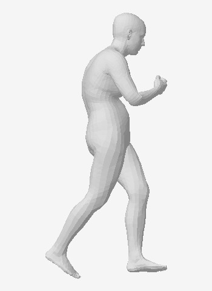](../2026-11-23_fixed_floor24/assets/pair022/side.jpg) | [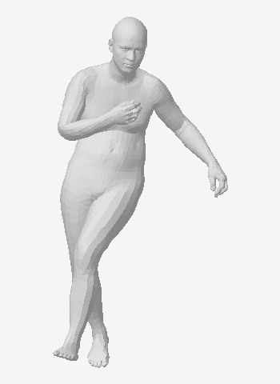](assets/pair022/front.jpg) |  | 53.59 | 58.98 |
| S1 / pair028 |  |  | [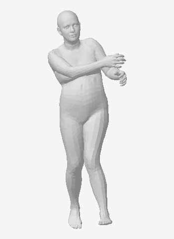](assets/pair028/front.jpg) | [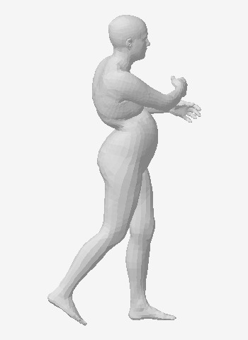](assets/pair028/side.jpg) | 32.58 | 64.84 |
| S1 / pair034 | [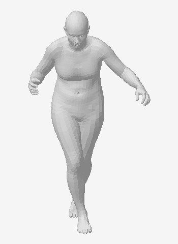](../2026-11-23_fixed_floor24/assets/pair034/front.jpg) | [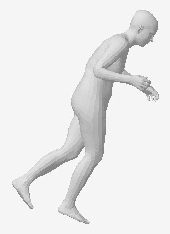](../2026-11-23_fixed_floor24/assets/pair034/side.jpg) | [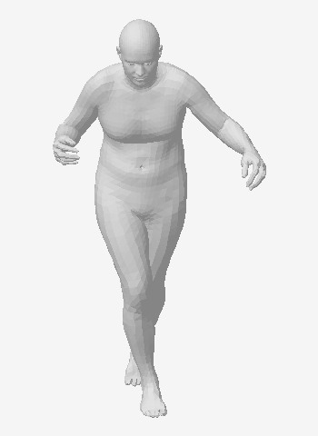](assets/pair034/front.jpg) | [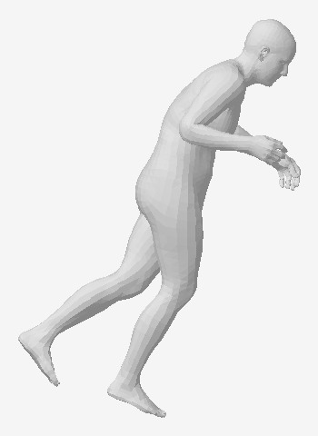](assets/pair034/side.jpg) | 48.13 | 60.77 |
| S9 / pair036 | [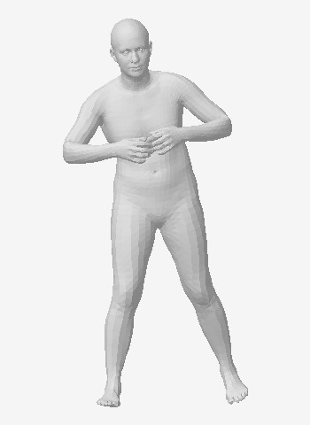](../2026-11-23_fixed_floor24/assets/pair036/front.jpg) | [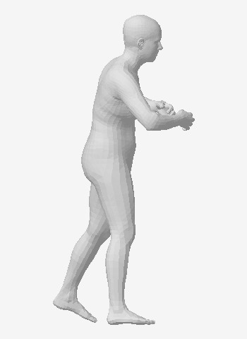](../2026-11-23_fixed_floor24/assets/pair036/side.jpg) | [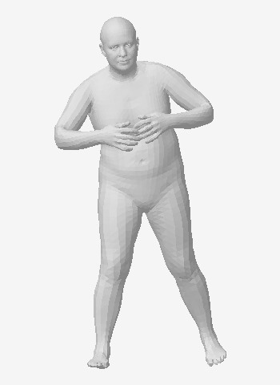](assets/pair036/front.jpg) | [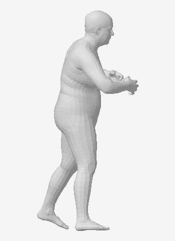](assets/pair036/side.jpg) | 32.04 | 50.03 |
| S9 / pair037 | [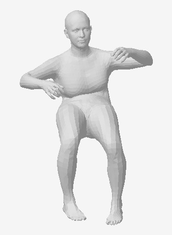](../2026-11-23_fixed_floor24/assets/pair037/front.jpg) | [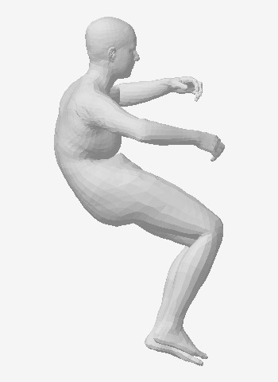](../2026-11-23_fixed_floor24/assets/pair037/side.jpg) |  | [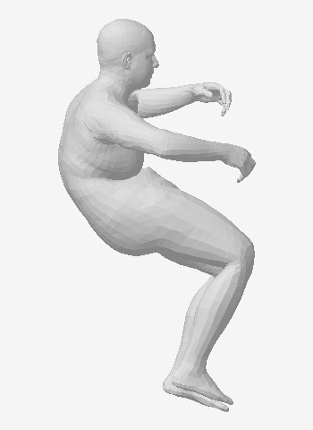](assets/pair037/side.jpg) | 43.42 | 48.69 |
| S9 / pair045 | [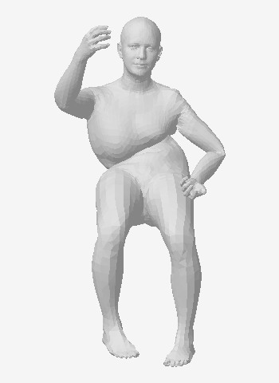](../2026-11-23_fixed_floor24/assets/pair045/front.jpg) | [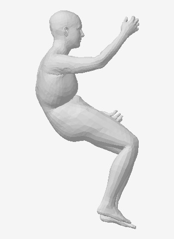](../2026-11-23_fixed_floor24/assets/pair045/side.jpg) | [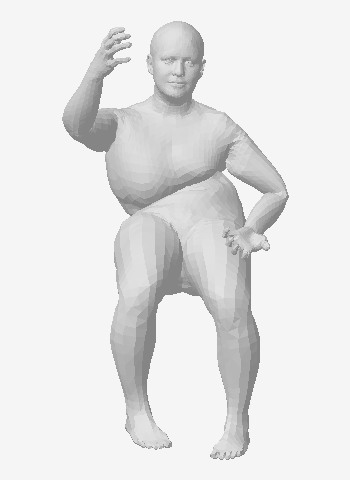](assets/pair045/front.jpg) | [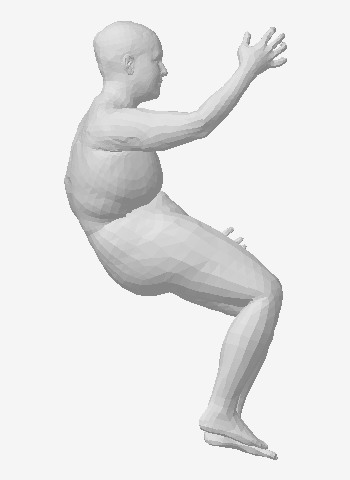](assets/pair045/side.jpg) | 41.80 | 46.08 |
| S9 / pair055 | [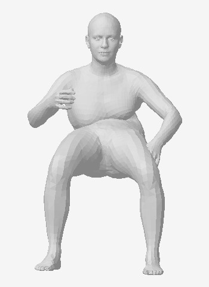](../2026-11-23_fixed_floor24/assets/pair055/front.jpg) | [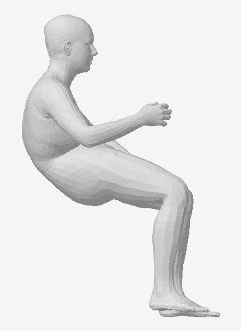](../2026-11-23_fixed_floor24/assets/pair055/side.jpg) | [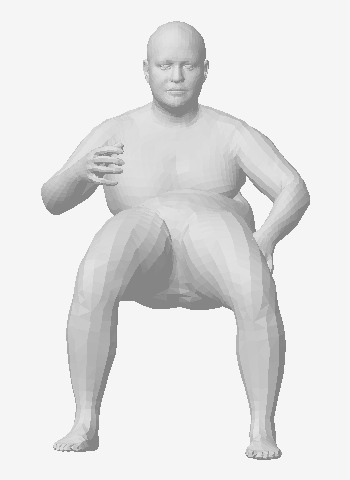](assets/pair055/front.jpg) | [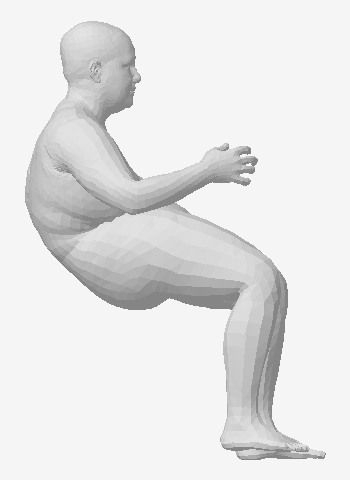](assets/pair055/side.jpg) | 41.62 | 46.06 |
| S11 / pair068 | [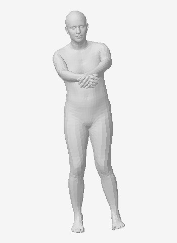](../2026-11-23_fixed_floor24/assets/pair068/front.jpg) | [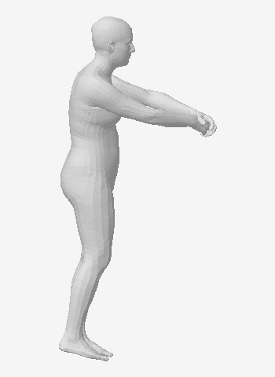](../2026-11-23_fixed_floor24/assets/pair068/side.jpg) | [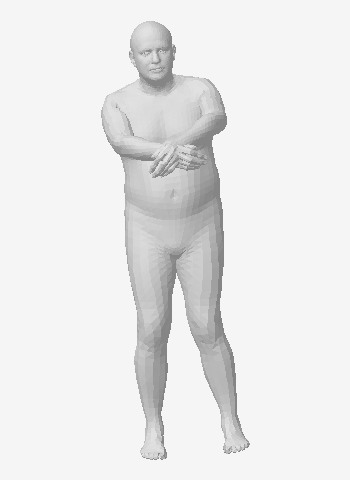](assets/pair068/front.jpg) | [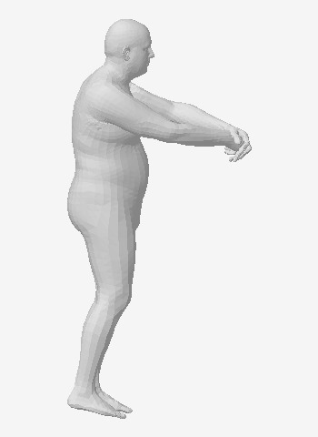](assets/pair068/side.jpg) | 32.64 | 44.97 |
| S11 / pair078 | [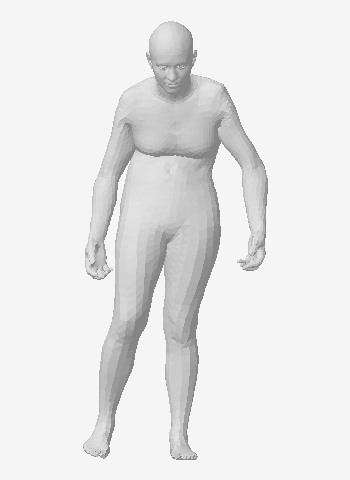](../2026-11-23_fixed_floor24/assets/pair078/front.jpg) | [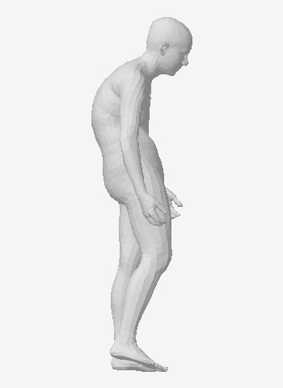](../2026-11-23_fixed_floor24/assets/pair078/side.jpg) |  | [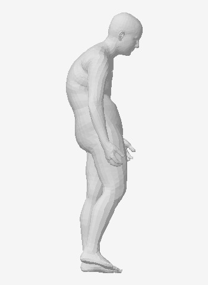](assets/pair078/side.jpg) | 33.02 | 73.67 |
| S11 / pair088 | [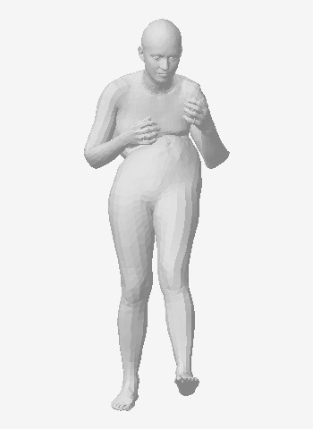](../2026-11-23_fixed_floor24/assets/pair088/front.jpg) | [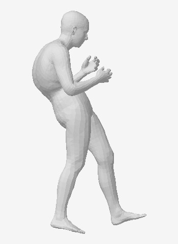](../2026-11-23_fixed_floor24/assets/pair088/side.jpg) | [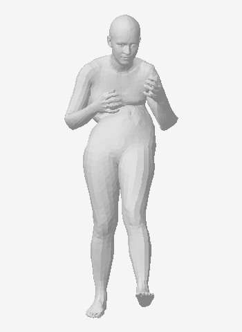](assets/pair088/front.jpg) | [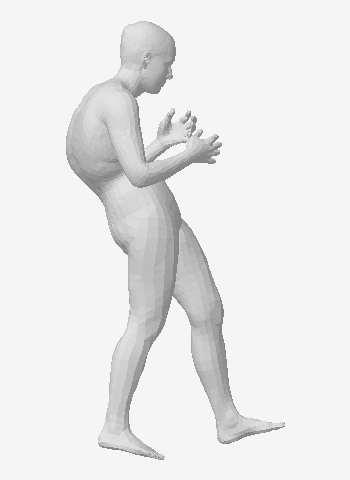](assets/pair088/side.jpg) | 40.39 | 78.00 |
| S11 / pair094 | [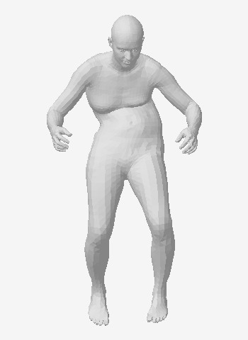](../2026-11-23_fixed_floor24/assets/pair094/front.jpg) | [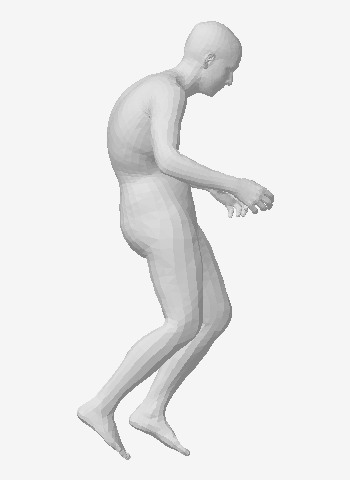](../2026-11-23_fixed_floor24/assets/pair094/side.jpg) | [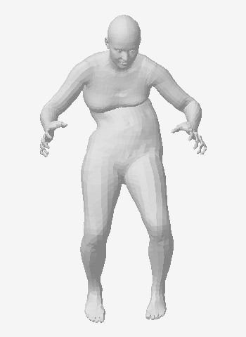](assets/pair094/front.jpg) | [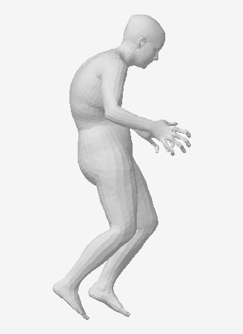](assets/pair094/side.jpg) | 37.81 | 60.75 |
| S3 / val017 | [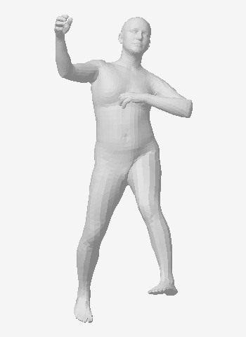](../2026-11-23_fixed_floor24/assets/val017/front.jpg) | [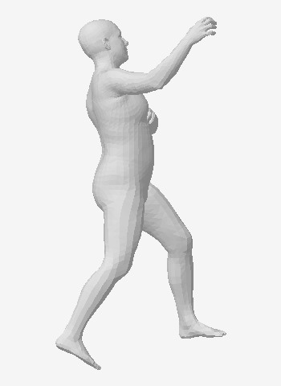](../2026-11-23_fixed_floor24/assets/val017/side.jpg) | [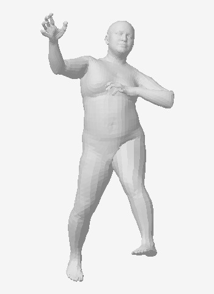](assets/val017/front.jpg) | [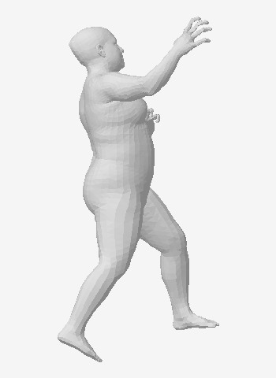](assets/val017/side.jpg) | 65.15 | 81.10 |
| S3 / val031 | [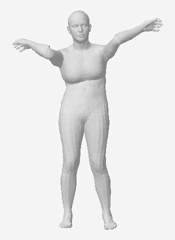](../2026-11-23_fixed_floor24/assets/val031/front.jpg) | [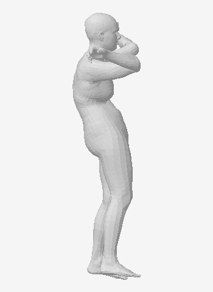](../2026-11-23_fixed_floor24/assets/val031/side.jpg) | [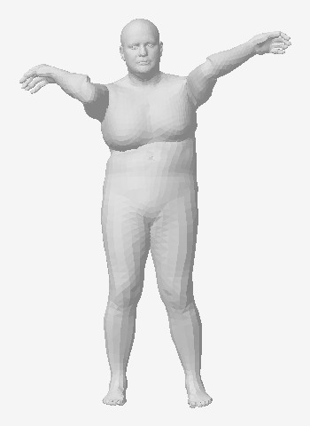](assets/val031/front.jpg) | [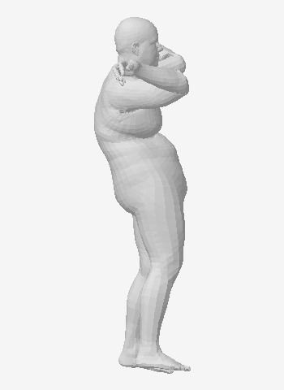](assets/val031/side.jpg) | 94.76 | 109.40 |
| S3 / val042 |  |  |  |  | 34.56 | 51.20 |
| S5 / val055 |  |  |  |  | 38.98 | 58.55 |
| S5 / val073 |  |  |  |  | 43.70 | 59.33 |
| S5 / val100 |  |  |  |  | 35.63 | 50.46 |
| S13 / val102 |  |  |  |  | 40.94 | 59.29 |
| S13 / val122 |  |  |  |  | 57.20 | 83.09 |
| S13 / val134 |  |  |  |  | 32.53 | 54.43 |
| S15 / val168 |  |  |  |  | 26.18 | 50.90 |
| S15 / val178 |  |  |  |  | 32.53 | 41.89 |
| S15 / val181 |  |  |  |  | 32.31 | 34.51 |

固定关节时使用原体型的骨架与蒙皮变换，将十维体型基的顶点位移通过固定蒙皮矩阵变换到每帧。系数以零初始化，限制在 ±3，优化 30 步，使用系数平方先验权重 0.03，选择轮廓与先验之和最低的迭代。该权重为本次试验设置。体表与骨架分开保存，不能直接只用新系数在标准 SMPL-X 中重建相同骨架。轮廓受衣物、遮挡和姿态偏差影响，24 帧同帧拟合尚无独立体表真值或留出动作验证。部分地面朝向为暂定，沿用原图库。

执行提交 68da491eaa477f4f4306fd4d01015f33e328a33e，工作树含本轮新增文件及已有无关改动。命令为 bash runs/2026-11-28_fixed_skeleton_shape/run.sh，依赖本机已有模型、归档姿态、分割概率和标定。首次运行缺少显式手面参数，第二次因矩阵精度不一致退出，修正后完整运行成功。OBJ 保存在仓库忽略的本轮输出目录，公开内容为渲染与脱敏数值。

推送前检查覆盖工作区、暂存文件、待推送提交及远端。工作区有先前存在的修改、数据和未跟踪文件，本轮仅暂存本 run 的源码、报告、脱敏指标和 48 张 OBJ 渲染；24 个 OBJ 留在忽略的本轮输出目录。检查增量文件类型和大小、凭据及机器路径，无完整本地 provenance 或 patch；本次增量检查不代表历史审计。[自检记录](evidence/prepush.json)
