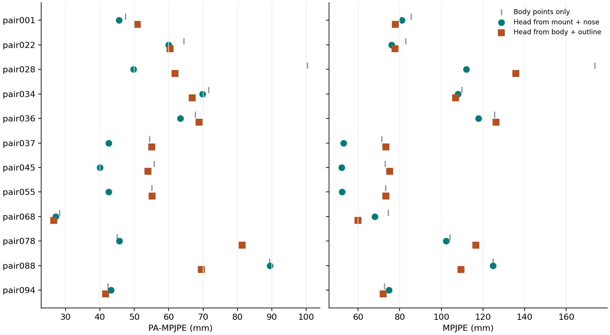

# 两种头部位置对身体姿态的影响 · RW 12 对

同一批 12 对双目图像，把前两轮各自估出的最终三维 Head 作为已知位置，重跑身体拟合。两组使用相同的相机、身体 12 点、根朝向初始化、均值体型和优化预算。

| 头位条件 | PA-MPJPE（mm） | 非 PA MPJPE（mm） |
|---|---:|---:|
| 无 Head 锚点 | 60.14 | 97.55 |
| 佩戴先验＋鼻尖得到的 Head | 51.59 | 85.17 |
| 身体点＋轮廓得到的 Head | 57.69 | 91.99 |

佩戴先验＋鼻尖的头位比身体点＋轮廓的头位平均低 6.10 mm PA、6.82 mm 非 PA。逐帧有 8 对 PA 更低、7 对非 PA 更低。限制到轮廓双眼可用的 8 对，两者差值为 7.42 mm PA 和 11.73 mm 非 PA。两种头锚点的配对距离平均为 137.79 mm。 [逐帧评分](evidence/results.json) · [计算核查](evidence/execution.json)

指标取左右肩、肘、腕、髋、膝和踝。非 PA 在左相机坐标直接算距离，PA 先逐帧进行平移、旋转和统一尺度对齐。PA 的差异表明两个已知头位也影响了身体关节的相对构型。无锚点参照来自上轮同一身体 12 点和相同优化预算。

| 样本 | 无头位 PA / 非 PA mm | 佩戴＋鼻尖 PA / 非 PA mm | 身体＋轮廓 PA / 非 PA mm |
|---|---:|---:|---:|
| pair001 | 47.38 / 85.33 | 45.53 / 81.02 | 50.86 / 77.92 |
| pair022 | 64.42 / 82.80 | 59.95 / 76.10 | 60.37 / 77.63 |
| pair028 | 100.27 / 173.68 | 49.80 / 111.93 | 61.85 / 135.73 |
| pair034 | 71.62 / 109.69 | 69.83 / 107.85 | 66.84 / 106.75 |
| pair036 | 67.75 / 125.55 | 63.40 / 117.83 | 68.80 / 126.18 |
| pair037 | 54.44 / 71.40 | 42.54 / 53.07 | 55.09 / 73.29 |
| pair045 | 55.71 / 73.04 | 40.05 / 52.06 | 54.00 / 75.15 |
| pair055 | 55.11 / 73.09 | 42.55 / 52.20 | 55.20 / 73.28 |
| pair068 | 28.28 / 74.39 | 27.14 / 68.02 | 26.64 / 59.93 |
| pair078 | 44.97 / 104.15 | 45.61 / 102.34 | 81.38 / 116.62 |
| pair088 | 89.33 / 124.84 | 89.46 / 124.72 | 69.50 / 109.41 |
| pair094 | 42.35 / 72.64 | 43.21 / 74.86 | 41.69 / 71.95 |

佩戴先验＋鼻尖一组的头位来自较早轮次的最终估计，其中 4 对也用了脸颈轮廓。另一组头位来自最近一轮身体 12 点＋轮廓，其中 8 对使用双目、4 对只有左眼轮廓。两组都逐步求解根平移以精确满足已知 Head，颈和头随上胸。朝向软约束权重为零，因此这项实验只比较头部位置的影响。标准 SMPL-X 重建逐帧确认锚点误差小于 0.001 mm。官标身体坐标在拟合封存后读取。 [佩戴和鼻尖头位](../2026-11-28_rw12_headonly/report.md) · [身体和轮廓头位](../2026-11-28_rw12_head_contour_only/report.md) · [本轮锚点](evidence/inputs.json)

执行基线 `206f23c453ca2d26052f2062ac4272a392381bba`，工作树含本轮新文件和先前无关改动。在 CPU 上完成两组共 24 个拟合，每个使用 20000 步预算。命令与状态记录在执行证据。发布前核对工作树、暂存、待推提交和远端。机器路径已脱敏，发布增量仅含代码、报告、数值及派生图表。 [推送自检](evidence/prepush.json)
