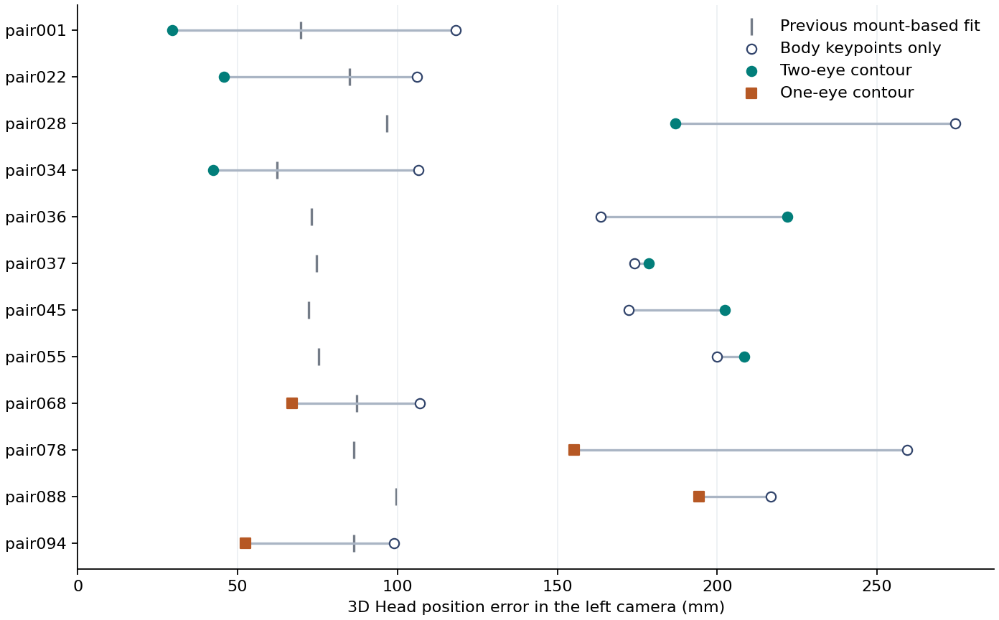

# 身体 12 点与脸颈轮廓反推头位 · 12 对双目帧

同一批 RW 图像，从双目身体点重拟合身体，随后用 Sapiens2 脸颈轮廓直接估计 Head 平移和旋转。评分使用左相机坐标下估计 Head 与官方 Head 的三维距离。

| 轮廓观测 | 对数 | 上轮佩戴初始化和鼻尖拟合 mm | 仅身体点 mm | 加轮廓 mm | 加轮廓改善 / 变差 |
|---|---:|---:|---:|---:|---:|
| 全部 | 12 | 80.72 | 166.44 | 132.09 | 8 / 4 |
| 双眼有可用轮廓 | 8 | 76.14 | 164.44 | 139.48 | 4 / 4 |
| 仅左眼有可用轮廓 | 4 | 89.87 | 170.45 | 117.30 | 4 / 0 |

加入轮廓后，全组误差中位数为 166.91 mm。pair001 的 Head 误差为 29.66 mm，pair036 为 221.85 mm。双眼可用的 8 对上，轮廓距离由 94.42 降到 36.13 px，三维误差 4 对降低、4 对升高。轮廓距离针对参与拟合的分割边界。上轮同时使用了不同的身体起点、佩戴先验、鼻尖与头颈旋转模型，表中用于对比最终精度。[逐帧原始数值](evidence/results.json)

pair037 的多起点解中，轮廓距离在最优解 1 px 内的头部朝向相差最高 62.59°。这反映本次搜索中分数接近的解对朝向的歧义。官方标注为三维 Head 点，表中的角度可复核但缺少旋转真值评分。

| 样本 | 左 / 右可用边缘点 | 仅身体点 mm | 加轮廓 mm | 变化 mm |
|---|---:|---:|---:|---:|
| pair001 | 226 / 265 | 118.12 | 29.66 | -88.46 |
| pair022 | 225 / 248 | 106.17 | 45.66 | -60.50 |
| pair028 | 181 / 249 | 274.39 | 186.95 | -87.44 |
| pair034 | 224 / 238 | 106.65 | 42.40 | -64.25 |
| pair036 | 15 / 32 | 163.67 | 221.85 | +58.18 |
| pair037 | 23 / 28 | 174.17 | 178.61 | +4.44 |
| pair045 | 22 / 29 | 172.35 | 202.28 | +29.94 |
| pair055 | 25 / 38 | 199.99 | 208.42 | +8.43 |
| pair068 | 28 / 3 | 106.95 | 67.11 | -39.84 |
| pair078 | 21 / 0 | 259.32 | 155.21 | -104.11 |
| pair088 | 27 / 6 | 216.67 | 194.35 | -22.32 |
| pair094 | 13 / 0 | 98.85 | 52.55 | -46.30 |

身体初始化从双目肩髋三角化求平移，根朝向取肩髋轴。身体拟合沿用原 12 点目标和均值体型，头位及朝向项权重为零。头部搜索从该身体的 Head 关节和上胸方向起步。头部变换按蒙皮权重混合到表面，允许 Head 在身体推算位置每轴 ±180 mm 内移动。这个范围限制搜索区域，损失只含双目可见轮廓距离。达到位置搜索边界附近的样本数见逐帧证据。旋转矩阵用左相机坐标表达。

从脸颈可见连通区域取二维边界，滤掉鱼眼视场边缘和眼镜附近，优先保留与背景或衣服相邻的边界。每只眼至少需要 8 个边界点。网格侧使用第一可见表面，经鱼眼投影后计算双向最近边界距离。鼻尖坐标和目标帧的官方 Head 均未用于估计。沿用此前在评测帧之外标定的相机外参。评分在全部拟合封存后读取上轮存档的官方坐标。[身体输入与协议](evidence/inputs.json) · [上轮同批](../2026-11-28_rw12_headonly/report.md)

执行基线 `9bb5130e748d31249fd873669afce70a14dfb21b`，工作树含本轮新增和先前无关改动。使用开发机 CPU、既有原图和分割缓存。命令、退出状态与自检见[执行记录](evidence/execution.json)。机器路径使用占位符，完整日志及模型留在开发机。发布前核对工作树、暂存、待推提交和远端，详见[发布自检](evidence/prepush.json)。
