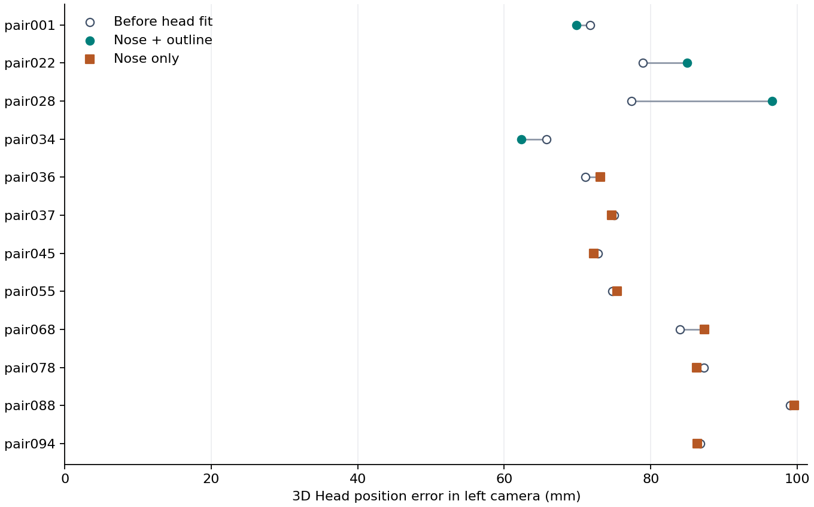

# RW 12 对 · 三维 Head 位置误差

按 Video 003 的头颈拟合方法，使用上一轮查看 Sapiens2 轮廓时的 12 对测试图像。误差为估计的 SMPL-X 原生 Head 关节与官方三维 Head 标注在左相机坐标下的欧氏距离，单位为毫米。

| 输入观测 | 对数 | 佩戴先验 | 头颈优化前 | 头颈优化后 | 改善 / 变差 |
|---|---:|---:|---:|---:|---:|
| 全部 | 12 | 78.46 | 78.70 | 80.72 | 6 / 6 |
| 鼻尖与双目脸颈轮廓 | 4 | 73.49 | 73.45 | 78.42 | 2 / 2 |
| 仅鼻尖 | 8 | 80.94 | 81.32 | 81.86 | 4 / 4 |

全组优化后三维误差中位数为 80.19 mm，最大为 99.57 mm。平均有符号 Z 偏差为 -67.24 mm，表示预测 Head 沿左相机光轴的坐标普遍偏小。使用双目轮廓的样本均来自 S1，平均鼻尖重投影 RMSE 由 218.45 降至 4.27 px。鼻尖属于拟合观测，官方 Head 是独立的位置评分。此对照采用两种观测条件，不宜直接比较两组的绝对误差来量化轮廓贡献。[逐帧坐标与误差](evidence/results.json) · [执行核查](evidence/execution.json)

| 人物 / 样本 | 脸颈边缘点 左 / 右 | 佩戴先验 mm | 拟合前 mm | 拟合后 mm | 变化 mm |
|---|---:|---:|---:|---:|---:|
| S1 / pair001 | 41 / 43 | 71.68 | 71.71 | 69.81 | -1.90 |
| S1 / pair022 | 43 / 42 | 79.07 | 78.93 | 84.94 | +6.01 |
| S1 / pair028 | 41 / 42 | 77.28 | 77.40 | 96.60 | +19.20 |
| S1 / pair034 | 45 / 41 | 65.93 | 65.76 | 62.34 | -3.42 |
| S9 / pair036 | 0 / 0 | 70.68 | 71.08 | 73.14 | +2.06 |
| S9 / pair037 | 0 / 0 | 74.04 | 74.99 | 74.64 | -0.35 |
| S9 / pair045 | 0 / 0 | 71.89 | 72.79 | 72.18 | -0.60 |
| S9 / pair055 | 0 / 0 | 73.68 | 74.72 | 75.44 | +0.72 |
| S11 / pair068 | 0 / 0 | 83.80 | 83.96 | 87.34 | +3.38 |
| S11 / pair078 | 0 / 5 | 87.29 | 87.26 | 86.25 | -1.01 |
| S11 / pair088 | 0 / 4 | 99.22 | 99.01 | 99.57 | +0.55 |
| S11 / pair094 | 0 / 1 | 86.94 | 86.79 | 86.33 | -0.46 |

与 Video 003 使用同一佩戴换算。眉心相对双目中点朝上、朝后各 5 cm，再加中性 SMPL-X 的眉心至 Head 偏移。公式复算与 Video 003 的初始锚点一致，移植时按 RW 会话外参换算到各自左相机坐标。按 RW20000 身体点重拟合黄金 D v3 并完成 v4 身体阶段，颈和头的局部旋转初始化为零，随上胸朝向。这里保留 v4 手部姿态，Video 003 的 v5 手部细化可能在个别帧改变面部遮挡。双目外参来自归档的场次标定，其中使用了评测帧以外的标注。目标帧官方 Head 只在全部结果封存后进入评分。[头位先验来源](../2026-11-25_realvideo4_dv3/report.md) · [Video 003 方法](../2026-11-28_video003_v5_headonly/report.md) · [RW 标定来源](../2026-11-18_rw_frozen200_golden_d/evidence/preparation.json)

原版 Sapiens2 提供第 178 通道鼻尖。沿用 Video 003 的脸颈连通区域、顶端边缘、眼镜排除、35° 单关节角度上限和多起点搜索。每眼至少 8 个可用边界点才合用双目轮廓。其余帧保留双目鼻尖与角度先验；这些帧的轮廓未达到原方法要求。仅开放颈与头的局部旋转，根平移固定，Head 位置只能沿骨骼运动。逐帧核对其余身体关节位置。[输入选择与哈希](evidence/inputs.json)

执行基线为 `8459affaffbdee353511042b95305fb4acd5de8c`，工作树含本轮新增代码及先前无关改动。开发机依次运行 run.sh body_start prepare、fit、candidates 和 fit_heads.sh，执行命令与退出状态见证据。初次准备阶段误要求标定序列完全不同，修正为检查标定帧排除后完整运行。[执行记录](evidence/execution.json)

发布前核对工作区、暂存内容、待推提交及远端。仅发布代码、报告、统计和派生图表，排除完整原始输出、模型、数据集、视频、数组、凭据、环境文件、开发机路径及完整 provenance 或 patch。检查范围为本轮增量。[发布自检](evidence/prepush.json)
