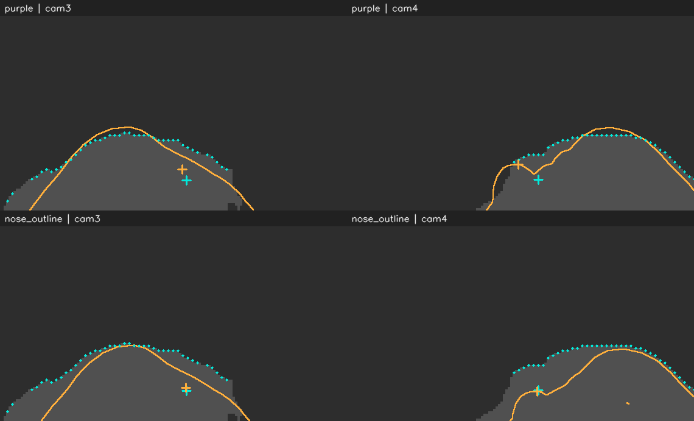

# Video 003 第 4 对 · 单帧头部位置与朝向估计

用双目鼻尖与分割脸缘，联合估计相对初始头部的三维平移和颈、头旋转。将估计结果应用于 SMPL-X 全身，再按双目肘腕点以同权校正肩肘。两眼鼻尖重投影 RMSE 由紫线方案的 32.6 降为 4.4 px，脸缘与嘴角误差上升。两组均使用该帧同一个身体起点和标定。

上排是紫线，下排为新方法。左、右分别为 cam3、cam4。青色十字和点为鼻尖检测与自动脸缘，橙色十字和线为模型投影。灰色是分割面部。原图叠加保存在本地输出目录。

| 同一对图，px | 紫线 | 鼻尖加轮廓 |
|---|---:|---:|
| 双目鼻尖 RMSE | 32.6 | 4.4 |
| 自动分割脸缘 MAE | 14.9 | 25.2 |
| 旧实验留出脸缘 MAE | 9.9 | 16.6 |
| 人工嘴角 RMSE | 34.2 | 45.8 |
| 肘点 RMSE | 5.0 | 4.8 |
| 腕点 RMSE | 8.9 | 9.0 |
| 全身 12 点 RMSE | 27.3 | 30.2 |

两组全身指标均按画内有效双目自动检测点计算。嘴角没有参与本轮头部拟合，旧版留出脸缘与新法外缘可能来自相同画面区域。自动点与自动分割存在误差，数值衡量二维贴合。原始逐眼点和参数见[结果](evidence/results.json)。

## 方法

复用身体与肩胯初始化、鱼眼标定、自动检测与分割。头部起点采用该帧 v4 身体派生的掌面起点，肩肘按同权优化；保留该帧头部初始方向。允许整个身体三维平移，以及颈和头各自三轴旋转。每项关节局部旋转最大 35°，每个平移分量不超过 150 mm。拟合双目鼻尖 RMSE 与自动脸缘 MAE，加入以零修正为中心的位置及角度软约束，使用多个起点的坐标搜索。两眼各自提取 42 和 44 个可见外缘点，排除眼镜附近区域及画框。模型鼻尖使用 SMPL-X 原生鼻部顶点，脸缘由全网格射线首次命中判断。

得到全身平移 [22.7, 46.6, 73.5] mm，紫线平移为 [16.9, 39.9, 72.4] mm。两组坐标均相对该帧起点，以 cam3 为坐标系。新法局部颈旋转约 0.05°、头旋转约 0.29°。这次优化得到较小的旋转，不能证明实际头部没有转动。解受位置和角度先验、目标权重、单帧观测、模型形状及搜索起点影响。

全身平移和局部旋转产生连续 SMPL-X 网格，再使用既有肩肘求解器分别校正双侧肩肘。躯干、髋腿不做额外重拟合，因此全身 12 点误差反映这次平移及肩肘修正的影响。鼻尖与自动脸缘为训练观测，没有真人三维真值，不能据此判定绝对三维精度或推广到其他帧。

## 复现和发布

基线 f62bbaf。开发机运行 `bash runs/2026-11-28_v003_04_head_6d/run.sh`。使用现有模型和 CPU 环境。逐项核对原始图像、检测、分割、标定和姿态归档哈希。原图叠加、完整网格及数组保留在本机输出目录。[代码](trial.py) · [执行及文件校验](evidence/execution.json)

推送前检查报告、暂存及待推增量。公开文件不含权重、数据集、视频、数组包、完整原始输出、路径、凭据、可识别受试者图像或完整 provenance，单文件小于 50 MB。公开图为无原图背景的模型和观测示意。
