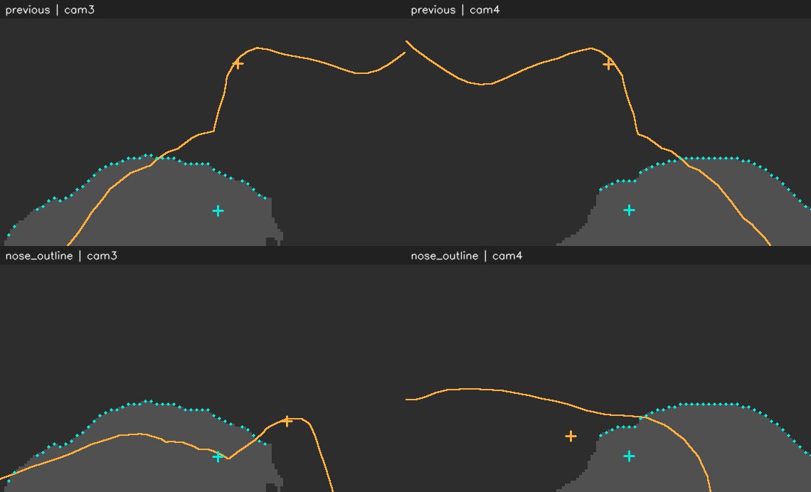

# Video 003 第 4 对 · 单帧鼻尖与面部外缘对齐

同一对鱼眼图中，以 Sapiens2 鼻尖和可见面部外缘驱动头颈后，鼻尖重投影 RMSE 由 207.9 降到 98.5 px。对照旧窗口检查下脸缘，误差由 32.2 升到 63.8 px，嘴角也偏得更远。固定身体时，本帧的局部旋转解只能兼顾部分观测。上一版为[脸缘加嘴角的局部头颈拟合](../2026-11-27_v003_04_free_neck/report.md)。

上排为上一版，下排为本轮。左列 cam3，右列 cam4。青色十字和点分别为自动鼻尖和用于拟合的可见外缘。橙色十字和线为模型鼻尖和可见面部边界。灰色区域来自图像分割，两排使用相同坐标和裁剪。原图叠加版保存在输出目录。

| 同一帧双目，原图像素 | 上一版：脸缘和嘴角 | 本轮：鼻尖和自动外缘 |
|---|---:|---:|
| 对自动鼻尖的二维 RMSE | 207.9 | 98.5 |
| 对自动外缘的纵向 MAE | 63.1 | 48.5 |
| 对旧版留出下脸缘列的纵向 MAE | 32.2 | 63.8 |
| 对人工近侧嘴角的二维 RMSE | 59.9 | 118.6 |

同一指标对两种方法使用完全相同的点。鼻尖与自动外缘进入新法拟合，嘴角进入旧法拟合。旧版留出的轮廓列来自同帧下脸缘，也可能与自动采样覆盖同一段轮廓。四项衡量二维观测的一致程度，缺少独立三维头姿真值。[观测坐标、每眼投影和各项误差](evidence/results.json)

## 单帧方法与复核

两组均从同一掌面起点、同权肩肘校正后的身体出发，使用同一标定、标准体型和 SMPL-X 层，仅优化颈和头的三轴局部旋转。上一版直接读取归档局部旋转，在当前前向模型中复算旧版脸缘与嘴角指标。新法按左右眼分别投影 SMPL-X 原生鼻部顶点 9120，对应检测器的 tip_of_nose 通道 178。以鼻尖所在的面颈连通区域为起点，并入上下唇、上下齿和舌。每隔 8 个原图像素取一列，保留上侧与背景或服装相接的外缘，避开画框及分割眼镜邻域。两眼分别留下 42 和 44 个自动外缘点。分割图每 4 像素采样，模型侧用全网格首个可见面部交点，两眼等权。

新法目标为鼻尖 RMSE、自动外缘 MAE 和每平方度 0.003 像素的姿态正则之和。使用多起点坐标搜索，每个局部旋转的幅度上限均为 35°。新解颈和头分别为 34.8°、35.0°，两组的双侧肩肘腕中心位移均为 0 mm。自动观测使鼻尖更接近，但最终两眼鼻尖仍有明显偏移。单帧无法区分佩戴位置、模板脸形、观测误差和头颈运动各自的贡献。没有使用相邻帧或重新估计相机位置。

## 复现与发布

基线提交 320fa53。运行仓库根目录下的 `bash runs/2026-11-28_v003_04_nose_outline/run.sh`，使用开发机已有的 CPU 环境、模型和本帧归档结果。[脚本](trial.py) · [执行与文件校验](evidence/execution.json)

发布前按暂存文件清单、类型、大小、敏感字符串及图片内容核查。本轮公开代码、文档、数值摘要和空白底图的几何叠加。单文件小于 50 MB，不含凭据、机器路径、权重、视频、原始数组、数据集、可识别受试者图像或完整原始输出。本地完整路径与运行 provenance 留在开发机。
