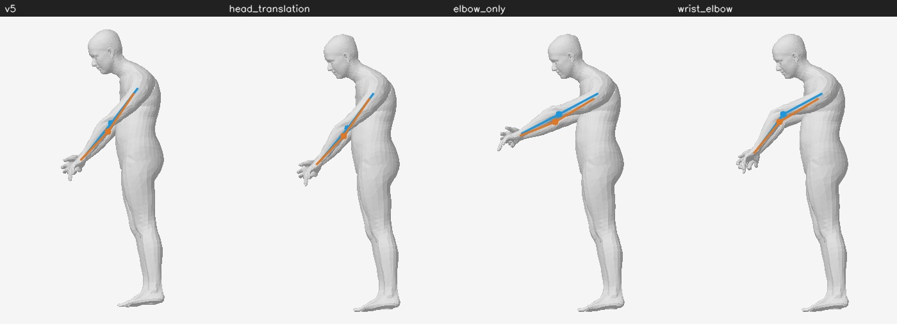
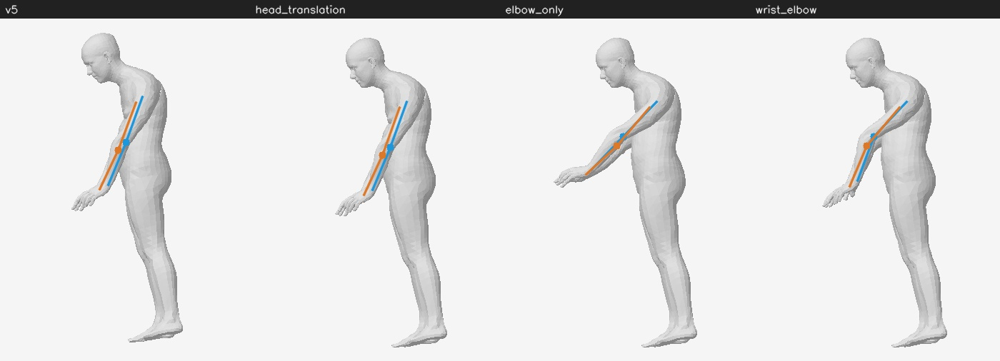

# Video 003 的脸部标记和第 3、8 对肘部诊断

新方案的两只手臂在全身随头平移后，再由肩肘优化器拉向双目肘腕检测点。第 3 对侧视图中，手臂被抬起，最终肘部与原 v5 相比明显弯曲，用户看到的上鼓现象在阶段对照中可以复现。第 8 对也有手臂方向和左肘角度变化。

两图从左到右是 strict v5、加入头部平移及头颈旋转、平移后只拟合肘点、平移后肘腕同权拟合。每行固定同一侧视方向、画布和尺度，蓝线与橙线为左右肩肘腕连线。只拟合肘点是额外对照，其腕位置误差很大。

| 对 / 手臂 | 初始 v5 肘角 | 头平移后肘角 | 只拟合肘点 | 肘腕同权最终 |
|---|---:|---:|---:|---:|
| 03 左 | 14.2° | 14.2° | 14.2° | 25.6° |
| 03 右 | 20.9° | 20.9° | 20.9° | 20.2° |
| 08 左 | 20.2° | 20.2° | 20.2° | 30.1° |
| 08 右 | 23.2° | 23.2° | 23.2° | 22.9° |

肘屈曲按肩到肘、肘到腕三维向量夹角计算，直臂为 0°。角度无法单独说明前臂在三维中弯向哪侧，也不能替代真实人体肘角真值。

第 3 对左肘，两眼初始投影误差 5.5 / 5.4 px，头部全身平移后为 74.6 / 69.7 px，最终仍为 28.5 / 28.2 px。左腕从平移后的 63.4 / 56.6 px 回到 5.0 / 5.6 px。第 8 对左肘从 5.3 / 4.8 px 经平移变为 68.3 / 63.3 px，最终为 11.6 / 11.5 px，左腕最终为 3.6 / 4.3 px。[逐侧、逐眼投影与数值](evidence/results.json)

平移本身保持肩肘腕夹角，画面上肘腕目标却未移动。肩肘求解器随后同时追踪肘腕目标，并以关节变化正则约束姿态。只用肘点时两帧手臂仍整体抬起，加入腕点后第 3 对左肘多弯约 11.4°，第 8 对多弯约 9.9°。因此整体手臂方向变化与肘腕的联合约束都应纳入判断；二维误差和单侧视图不足以断定每一关节的真实姿态。

## 脸部标记

十对完整原图保存在本机的 face_observations.zip。每张左为 cam3，右为 cam4，青色十字是 Sapiens2 鼻尖，青点是从面部分类提取的外缘，橙色十字是模型鼻尖，橙线是整个网格射线首次命中的可见头面部边界。脸缘和鼻尖是拟合目标。

## 实验与发布

复用前次导出的 strict v5 和鼻尖后 OBJ、双目检测及标定。最终 OBJ 与参数重建的最大顶点差小于 1e-8 m。固定头平移与同权损失重跑肩肘，参数与原结果最大差小于 1e-5。局部输出与私有原图保留在开发机。基线 ae475d0。[代码](audit.py) · [执行证据](evidence/execution.json)

发布前检查暂存清单、内容和大小。公开文件只包含诊断代码、脱敏数值、标准体型模型示意与文档，单文件小于 50 MB，不含原图、权重、视频、原始数组、完整原始输出、个人凭据、开发机路径及完整 provenance。
